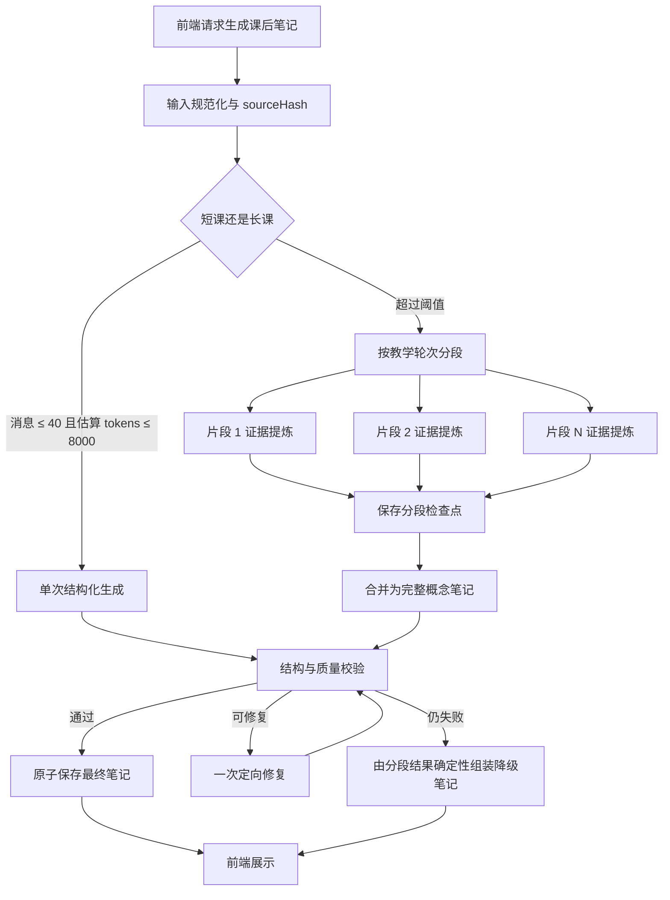

# Socratopia 课后笔记质量与可靠性开发方案

> 方案版本：v1.0  
> 制定日期：2026-09-15  
> 适用目录：`E:\huanjing\sogeladi\Socratopia`  
> 实施对象：Windows 打包产物中的 `/api/concept-summary`、共享服务模块和课后笔记前端  
> 核心要求：长课堂不因超时或 JSON 截断失败；恢复完整笔记质量；每个改动与运行阶段都有可核验留痕；测试只在阶段门禁集中执行

## 0. 文档目的

当前课后笔记采用一次非流式模型调用处理完整课堂。真实长课堂已出现三类问题：

1. 上游网关返回 HTML 403 页面，接口直接执行 `response.json()`，前端看到 `Unexpected token '<'`。
2. 80 条课堂消息形成约 14,078 prompt tokens；模型即使收到 `thinking: disabled`，仍可能生成大量 reasoning，单次生成超过 180 秒后被中止。
3. 模型偶尔返回 HTTP 200，但 `message.content` 为空，或返回在 JSON 数组中途截断的内容，第二次重试仍可能失败。

当前将输出限制为 4,096 tokens、整份 JSON 不超过 1,800 字符，是恢复可用性的临时止血措施。它提高了成功率，但会压缩长课笔记的细节。本方案用于把临时止血升级为兼顾质量、可靠性和可追踪性的正式实现。

## 1. 已确认的事实基线

### 1.1 项目形态

本目录是 Electron + Next.js 的 Windows 打包产物，没有可重新构建 `.next` 的源码流水线。

- 可按普通源文件维护：`resources/server/server.js`、`resources/server/lib/**`。
- 生成产物，只能做外科式补丁：`resources/server/.next/server/**`、`resources/server/.next/static/**`。
- Server 直接从 `resources/server/` 原地运行，服务端改动重启应用后生效。
- `win-unpacked/` 是旧版本快照，不自动同步，不作为本次修改目标。
- 不新增 API 路由，继续使用 `/api/concept-summary`，因此不需要修改三个 route manifest。

### 1.2 真实故障证据

| 证据编号 | 观察 | 结论 |
|---|---|---|
| E-PN-001 | 请求 `02:05:19.816Z` 发起，`02:08:19.823Z` 中止 | 精确命中 180 秒后端超时 |
| E-PN-002 | 80 条消息、20,003 正文字符、14,078 prompt tokens | 长课输入规模已经进入高延迟区 |
| E-PN-003 | 第一轮约 150 秒返回 200，但 `content` 为空 | HTTP 200 不等于可用模型结果 |
| E-PN-004 | 第二轮约 126 秒返回 5,836 字符，JSON 中途截断 | 必须检查 `finish_reason` 和结构完整性 |
| E-PN-005 | 2,048 tokens 对照请求约 16.5 秒返回 | 输出预算显著影响延迟 |
| E-PN-006 | 4,096 tokens + JSON mode + 1,800 字符约束约 64.5 秒返回完整 JSON | JSON mode 和显式长度约束有效 |
| E-PN-007 | 上游故障时返回 HTTP 403、`text/html`、`<!DOCTYPE ...>` | 必须先读文本并校验响应类型 |
| E-PN-008 | 同一上游后来恢复 HTTP 200 | 网关异常具有间歇性，不能按永久鉴权失败处理 |

### 1.3 当前实现的结构问题

1. 完整课堂只有一次大调用，输入、reasoning 和最终内容共享同一个输出时限。
2. “最多重试两次”只覆盖模型正文 JSON 解析失败；网络异常、HTML 响应和 abort 会直接跳出循环。
3. 没有分段检查点；最后一步失败时，前面所有计算结果全部丢失。
4. 没有生成任务状态；前端只知道 loading、ready、error。
5. 没有质量度量，无法区分“生成成功但遗漏严重”和“高质量完成”。
6. 运行日志记录了大量原始模型内容，不适合长期留痕，也不利于检索。

## 2. 产品目标与验收指标

### 2.1 产品目标

短课堂继续快速生成；长课堂通过分段提炼和最终合并生成完整笔记。最终笔记应保留：

- 本节真实讨论过的核心概念；
- 学习者答对、答错、困惑和发生理解转变的位置；
- 伙伴给出的关键解释、例子、公式和边界条件；
- 学习者真实说出的关键洞见；
- 尚未解决的问题；
- 3～5 道覆盖本节重点的复习题。

### 2.2 可靠性指标

| 指标 | 目标 |
|---|---:|
| 短课生成成功率 | ≥ 98% |
| 长课生成成功率 | ≥ 95% |
| 短课 P90 完成时间 | ≤ 60 秒 |
| 长课 P90 完成时间 | ≤ 180 秒 |
| HTML/非 JSON 被误报为 JSON 语法错误 | 0 次 |
| 输出中途截断后仍被当作成功保存 | 0 次 |
| 同一会话重复点击产生并发重复任务 | 0 次 |
| 失败后可利用检查点续跑 | 100% 的分段任务 |

### 2.3 质量指标

| 指标 | 短课 | 长课 |
|---|---:|---:|
| 中文正文建议长度 | 1,200～2,500 字符 | 3,000～5,000 字符 |
| 英文正文建议长度 | 700～1,400 words | 1,500～2,500 words |
| 核心概念覆盖率 | ≥ 85% | ≥ 90% |
| 重复 section 比例 | ≤ 10% | ≤ 10% |
| 复习题数量 | 2～4 | 3～5 |
| `key-insight` 无来源引用 | 0 |
| 不在课堂证据中的新主题 | 0 |

质量指标不要求把所有课堂原话搬入笔记。它要求主题完整、事实忠实、层次清晰，并保留足够的解释和复习价值。

## 3. 总体技术方案

### 3.1 双路径生成



### 3.2 短课路径

满足以下两个条件时使用单次生成：

```text
有效消息数 <= 40
估算输入 tokens <= 8,000
```

建议参数：

```js
maxTokens: 4096
responseFormat: "json_object"
timeoutMs: 120000
visibleLength: 中文 1200～2500 字符 / 英文 700～1400 words
```

短课路径保留现有体验，避免为十几轮课堂增加不必要的多次模型调用。

### 3.3 长课路径

超过短课阈值时，按完整“学习者发言 + 伙伴回应”轮次切片：

- 每片目标输入：3,500～5,000 tokens；
- 不在一组问答中间切断；
- 相邻片段保留 1 个完整问答轮次作为重叠；
- 最大并发为 2，避免短时间向不稳定网关发起大量请求；
- 每片成功后立即原子写入检查点；
- 某一片失败只重跑该片，不重跑已完成片段。

每个片段输出“证据摘要”，而不是最终排版后的笔记：

```json
{
  "chunkId": "chunk-002",
  "messageRange": [21, 42],
  "topics": [
    {
      "name": "词法单元、模式与词素",
      "facts": ["..."],
      "examples": ["..."],
      "sourceMessageIndexes": [25, 26, 31]
    }
  ],
  "learnerEvidence": [
    {
      "kind": "misconception",
      "content": "...",
      "sourceMessageIndexes": [33, 34]
    }
  ],
  "keyInsights": [],
  "openQuestions": [],
  "reviewCandidates": []
}
```

片段阶段只提取证据，不进行华丽扩写。最终合并阶段才能组织叙事、补充已经讨论过的概念细节并生成复习题。

### 3.4 最终合并

最终合并只读取分段证据 JSON，不再重新发送完整原始课堂。建议参数：

```js
maxTokens: 4096
responseFormat: "json_object"
timeoutMs: 150000
visibleLength: 中文 3000～5000 字符 / 英文 1500～2500 words
```

合并 prompt 必须包含以下硬约束：

1. 主题只能来自分段证据。
2. `key-insight` 必须携带有效 `sourceMessageIndexes`，否则省略。
3. 合并重复概念，不按片段机械堆叠。
4. 优先保留学习者的误区、纠正过程、关键解释和完整推导。
5. 复习题覆盖不同概念，避免只是改写同一个问题。
6. 最终输出只包含 JSON。

### 3.5 确定性降级结果

如果所有片段都已成功，但最终合并连续失败，不应把整次任务判为失败。服务端按固定模板组合片段结果：

- 第一条核心主题生成 `tldr`；
- 按首次出现顺序合并 `topics`，同名概念去重；
- 按证据顺序组织 `learnerEvidence`；
- 合并不重复的 `openQuestions`；
- 从 `reviewCandidates` 取 3～5 项。

确定性组装的文风会弱于模型合并，但信息不会丢失，并且能够正常保存、展示和导出。

## 4. 后端模块设计

### 4.1 新增手写模块

新增：

```text
resources/server/lib/post-class-notes/orchestrator.js
resources/server/lib/post-class-notes/partitioner.js
resources/server/lib/post-class-notes/schema.js
resources/server/lib/post-class-notes/checkpoint-store.js
resources/server/lib/post-class-notes/quality.js
resources/server/lib/post-class-notes/errors.js
```

职责分离：

| 文件 | 职责 |
|---|---|
| `orchestrator.js` | 任务状态机、并发控制、调用 map/reduce、恢复与降级 |
| `partitioner.js` | 消息清洗、token 估算、保持问答轮次的切片 |
| `schema.js` | 片段证据与最终笔记 schema 校验、规范化 |
| `checkpoint-store.js` | 原子写、断点续跑、过期清理、single-flight 状态 |
| `quality.js` | 覆盖率、重复率、来源完整性、长度与 section 质量评分 |
| `errors.js` | HTTP、HTML、鉴权、限流、网络、超时、空内容、截断分类 |

生成产物中的复杂逻辑应尽量迁出 `route.js`，放入上述可维护、可单测的手写模块。

### 4.2 全局注入

在 `resources/server/server.js` 的 `__loadOptionalGlobal__` 表中新增：

```js
["__POST_CLASS_NOTES__", "./lib/post-class-notes/orchestrator.js", "[post-class-notes] Orchestrator"]
```

编译路由只访问 `global.__POST_CLASS_NOTES__`，不在 `.next/server/chunks/*.js` 中直接 `require("fs")`。

### 4.3 路由适配

修改：

```text
resources/server/.next/server/app/api/concept-summary/route.js
```

保留现有 GET 读取接口，扩展 POST action：

```text
start   创建或复用生成任务
status  查询进度（也可由 GET + jobId 提供）
cancel  取消仍在执行的任务
retry   从已有检查点继续
```

建议响应：

```json
{
  "jobId": "pn_01J...",
  "traceId": "tr_01J...",
  "status": "running",
  "stage": "map",
  "completedChunks": 2,
  "totalChunks": 4,
  "progress": 0.45
}
```

完成后：

```json
{
  "jobId": "pn_01J...",
  "traceId": "tr_01J...",
  "status": "ready",
  "summary": { "...": "现有兼容结构" },
  "quality": {
    "score": 0.91,
    "coverage": 0.93,
    "warnings": []
  }
}
```

### 4.4 任务状态机

```text
created
  -> partitioning
  -> mapping
  -> reducing
  -> validating
  -> persisting
  -> ready

任意执行阶段
  -> retry_wait
  -> 原阶段

不可恢复
  -> degraded
  -> ready

用户取消
  -> cancelled

无检查点且不可恢复
  -> failed
```

只有 `ready` 状态允许写正式概念笔记文件。`running`、`retry_wait`、`failed` 不得覆盖已有成功笔记。

## 5. 持久化与断点续跑

### 5.1 文件位置

在现有用户世界目录中使用：

```text
concept-summaries/
  <conversationId>.json                 # 正式笔记，保持现有兼容
  .jobs/
    <conversationId>/
      <jobId>/
        job.json                         # 状态和阶段
        partition.json                   # 分片边界，无原始正文
        chunks/
          chunk-001.json                 # 片段证据
          chunk-002.json
        quality.json                     # 质量检查结果
        trace.jsonl                      # 结构化运行留痕
```

### 5.2 原子写

所有 JSON 文件使用：

```text
写入 <name>.tmp-<pid>-<random>
fsync/close
rename 到正式文件
```

Windows `EPERM` 使用有上限的退避重试，沿用项目已有的 10 次原子写重试基线。正式笔记保存失败时保留 job 检查点，不重新调用模型。

### 5.3 幂等键

任务幂等键：

```text
accountId + profileId + worldId + conversationId + sourceHash + pipelineVersion
```

相同幂等键：

- 已完成：直接返回已生成笔记；
- 正在运行：返回现有 jobId；
- 部分完成：从缺失片段继续；
- pipelineVersion 改变：创建新任务，旧结果保留到新结果成功写入。

### 5.4 清理策略

- 成功任务检查点保留 7 天；
- 失败任务保留 14 天，便于排查；
- 每个 conversation 最多保留 5 个 job；
- 清理只删除 `.jobs/` 下明确过期的任务目录；
- 正式笔记永不由清理器删除。

## 6. 上游调用与错误策略

### 6.1 响应读取顺序

所有课后笔记模型调用按以下顺序处理：

1. `await response.text()`；
2. 记录 status、Content-Type、响应字节数和耗时；
3. 非 2xx 先分类，不进入模型正文解析；
4. `text/html` 或 `<!DOCTYPE` 分类为 `upstream_html_response`；
5. JSON.parse provider envelope；
6. 检查 `choices[0].finish_reason`；
7. 提取 `message.content`；
8. content 为空时，仅当 `message.reasoning` 本身能完整解析为符合 schema 的 JSON 才允许恢复；
9. 对最终内容执行 schema 与质量校验。

### 6.2 重试矩阵

| 错误 | 是否重试 | 次数 | 说明 |
|---|---:|---:|---|
| DNS、连接重置、临时 fetch 失败 | 是 | 1 | 1.5～3 秒抖动退避 |
| 408、502、503、504 | 是 | 1 | 不连续轰击网关 |
| 429 | 条件重试 | 1 | 尊重 `Retry-After`，最大等待 30 秒 |
| HTML 403 拦截页 | 是 | 1 | 延迟 3 秒；仍失败则明确报告上游拦截 |
| 普通 401/403 JSON 鉴权错误 | 否 | 0 | 提示检查 endpoint 与 key 是否匹配 |
| 400 schema/参数错误 | 否 | 0 | 属于开发错误，直接留痕 |
| 空 content | 是 | 1 | 第二次使用更短、更严格 prompt |
| `finish_reason=length` | 是 | 1 | 缩短目标内容，不重复相同请求 |
| 最终 JSON schema 不合格 | 是 | 1 | 只发送坏结果和 schema 做定向修复 |
| 用户取消 | 否 | 0 | 立即传播 AbortSignal |

单个片段最多发生两次上游调用。整个任务设置总调用数上限，防止逻辑错误造成无限消耗。

### 6.3 超时预算

| 阶段 | 单次超时 | 重试 | 总预算 |
|---|---:|---:|---:|
| 短课单次生成 | 120 秒 | 1 | 210 秒 |
| 长课 map 单片 | 90 秒 | 1 | 150 秒/片 |
| 长课 reduce | 150 秒 | 1 | 240 秒 |
| schema 定向修复 | 60 秒 | 0 | 60 秒 |
| 整个后台 job | — | — | 5 分钟软上限、8 分钟硬上限 |

达到软上限后停止新重试；达到硬上限后从已完成片段生成确定性降级笔记。

## 7. 质量保障设计

### 7.1 自适应长度，不使用统一 1,800 字符上限

建议按有效消息数量确定目标长度：

| 有效消息 | 中文目标字符 | 策略 |
|---:|---:|---|
| 2～15 | 800～1,500 | 简短概念卡 |
| 16～40 | 1,500～2,500 | 单次完整笔记 |
| 41～80 | 3,000～4,000 | 分段 + 合并 |
| 81～160 | 4,000～5,000 | 分段 + 合并 |
| >160 | 5,000 上限 | 更细分片，最终仍控制可读长度 |

### 7.2 证据约束

内部 map 结果保留 `sourceMessageIndexes`。最终 UI 可以不显示索引，但质量检查必须验证：

- 每个核心 concept 至少有一个来源索引；
- 每个 learner misconception 至少有一个用户消息来源；
- `key-insight` 必须指向学习者消息；
- 只由教材标题推断、没有课堂消息来源的主题必须删除；
- 补充背景知识只能写入已经有课堂来源的 concept body。

### 7.3 质量评分

```text
qualityScore =
  0.30 * topicCoverage
  + 0.20 * learnerEvidenceCoverage
  + 0.15 * explanationCoverage
  + 0.10 * sourceIntegrity
  + 0.10 * reviewQuestionDiversity
  + 0.10 * structureValidity
  + 0.05 * lengthFitness
  - duplicationPenalty
  - unsupportedTopicPenalty
```

判定：

- `score >= 0.80`：直接通过；
- `0.65 <= score < 0.80`：执行一次定向修复；
- `score < 0.65`：优先重新合并，仍失败则确定性降级；
- `sourceIntegrity < 1.0`：无论总分多少都不能直接通过。

### 7.4 兼容现有 UI

最终 `summary.sections` 继续使用已有八种 section：

```text
tldr
narrative
concepts
key-insight
open-question
key-terms
review-questions
notes
```

内部新增的 evidence、quality、trace 字段放在 `generationMeta`，旧前端忽略额外字段也能正常显示。

## 8. 前端设计

### 8.1 生成状态

当前 `loading-cache / generating / ready / error` 扩展为：

```text
loading-cache
preparing
extracting
merging
checking
saving
ready
degraded
error
cancelled
```

用户界面只展示简洁文字：

- 正在整理课堂内容；
- 正在提取第 2/4 段重点；
- 正在合并完整笔记；
- 正在检查遗漏；
- 正在保存。

### 8.2 轮询策略

- 创建任务后每 1.5 秒查询一次；
- 30 秒后改为每 3 秒；
- 窗口失焦后每 8 秒；
- 回到前台立即查询一次；
- `ready / degraded / failed / cancelled` 后停止轮询；
- 网络查询失败不自动创建新 job。

### 8.3 错误展示

界面根据稳定错误 code 显示：

| code | 文案 |
|---|---|
| `upstream_html_response` | 模型服务当前被网关拦截，请稍后重试 |
| `upstream_timeout` | 模型服务响应过慢，已保留生成进度 |
| `upstream_auth` | 模型地址和 API Key 不匹配 |
| `upstream_rate_limit` | 模型服务繁忙，请稍后继续 |
| `output_truncated` | 模型输出不完整，正在从检查点重试 |
| `quality_rejected` | 笔记完整度不足，正在重新整理 |
| `persist_failed` | 笔记已生成，但保存失败；可直接重试保存 |

错误详情中显示短 traceId，便于用户提供问题编号。界面不显示 API key、完整 endpoint、原始 HTML 或模型 reasoning。

## 9. 全链路留痕规范

“每处留痕”分为四层，缺少任一层都不算完成。

### 9.1 代码变更留痕

每个修改点使用固定变更编号：

| 变更编号 | 文件 | 计划改动 | 必须产生的留痕 |
|---|---|---|---|
| PN-001 | `lib/post-class-notes/partitioner.js` | 消息清洗和切片 | 单测、分片统计日志、WORKSTATE 条目 |
| PN-002 | `lib/post-class-notes/schema.js` | 两级 schema 和规范化 | schema fixture、拒绝原因统计 |
| PN-003 | `lib/post-class-notes/errors.js` | 上游错误分类 | 错误矩阵测试、错误 code 文档 |
| PN-004 | `lib/post-class-notes/checkpoint-store.js` | 原子检查点和恢复 | 原子写 smoke、恢复日志 |
| PN-005 | `lib/post-class-notes/quality.js` | 质量评分 | 固定 fixture 分数快照 |
| PN-006 | `lib/post-class-notes/orchestrator.js` | map/reduce 状态机 | 状态转换测试、job trace |
| PN-007 | `resources/server/server.js` | 全局模块注入 | 启动日志 `[post-class-notes] ... loaded` |
| PN-008 | `concept-summary/route.js` | 路由薄适配层 | route integration smoke、请求 traceId |
| PN-009 | 前端 page chunk | job 进度和错误界面 | UI smoke、状态截图或 DOM fixture |
| PN-010 | `WORKSTATE.md` | 批次记录 | 改前/改后证据和验证结果 |
| PN-011 | `04-bug-ledger.md` | 缺陷登记与关闭标准 | BUG 编号、状态变更理由 |
| PN-012 | `outputs/post-class-notes-v2/` | 验证产物 | manifest、命令、退出码、摘要 |

每次实施只处理表中的明确编号。提交说明、工作日志、测试报告都引用同一个 PN 编号。

### 9.2 运行时结构化留痕

每个 job 创建 `traceId`，每条日志使用同一前缀：

```text
[post-class-notes][trace=tr_xxx][job=pn_xxx] stage=map event=started chunk=2/4
```

`trace.jsonl` 每行结构：

```json
{
  "at": "2026-09-15T02:10:00.000Z",
  "traceId": "tr_xxx",
  "jobId": "pn_xxx",
  "conversationHash": "sha256:...",
  "pipelineVersion": "post-class-v2",
  "stage": "map",
  "event": "provider_response",
  "attempt": 1,
  "chunk": 2,
  "totalChunks": 4,
  "elapsedMs": 18422,
  "httpStatus": 200,
  "contentType": "application/json",
  "promptTokens": 4210,
  "completionTokens": 1320,
  "contentChars": 2190,
  "finishReason": "stop",
  "outcome": "ok"
}
```

禁止写入 trace：

- API key、session token、Authorization header；
- 完整原始课堂正文；
- 完整模型 reasoning；
- 上游 HTML 页面正文；
- 用户真实姓名、设备标识等不必要字段。

### 9.3 质量留痕

`quality.json` 至少保存：

```json
{
  "schemaVersion": 1,
  "pipelineVersion": "post-class-v2",
  "sourceHash": "sha256:...",
  "sourceMessageCount": 80,
  "chunkCount": 4,
  "score": 0.91,
  "metrics": {
    "topicCoverage": 0.94,
    "learnerEvidenceCoverage": 0.88,
    "sourceIntegrity": 1,
    "duplicationRatio": 0.04,
    "lengthChars": 3860
  },
  "warnings": [],
  "decision": "accepted"
}
```

### 9.4 开发验证留痕

每个阶段只生成一次集中验证目录：

```text
outputs/post-class-notes-v2/<stage>-<timestamp>/
  manifest.json
  commands.txt
  results.json
  changes.patch
  before.sha256
  after.sha256
  logs/
```

`results.json` 记录每条命令、开始和结束时间、退出码、PASS/FAIL、失败摘要。不得只写“测试通过”而没有命令和输出证据。

## 10. 分阶段实施计划

### 阶段 A：固定基线与回滚材料

目标：不改业务行为，建立一次性基线。

工作：

1. 创建 `outputs/post-class-notes-v2/baseline-<timestamp>/`。
2. 保存目标文件 sha256、当前 diff、相关日志时间段和当前 smoke 结果。
3. 在 `WORKSTATE.md` 新增 `PN-V2-A` 条目。
4. 在 `04-bug-ledger.md` 登记本问题，包含 HTML、timeout、空 content、截断四种症状。

留痕：baseline manifest、changes.patch、日志摘录、BUG 编号。

阶段门禁：只运行一次现有概念总结 3 个 smoke 和 route `node --check`。

### 阶段 B：实现纯逻辑核心

目标：完成 partition、schema、errors、quality，不接入真实路由。

工作：

1. 实现消息规范化和分片。
2. 实现片段证据 schema 与最终笔记 schema。
3. 实现错误分类。
4. 实现质量评分与确定性降级组装。
5. 使用固定匿名 fixture 覆盖短课、80 条长课、代码/公式、多语言、空消息和重复内容。

留痕：PN-001/002/003/005，fixture 版本、质量分数快照、WORKSTATE 批次记录。

阶段门禁：完成全部文件后集中运行一次核心模块 smoke；期间不逐文件反复运行。

### 阶段 C：检查点和 orchestrator

目标：完成可恢复 job，不修改前端。

工作：

1. 实现 checkpoint-store 原子写和清理。
2. 实现 single-flight 和幂等键。
3. 实现短课 direct、长课 map/reduce、一次定向修复和确定性降级。
4. 用 MockLLM 模拟：成功、HTML 403、DNS、429、空 content、reasoning-only、length、abort、保存 EPERM。
5. 验证中途失败后只重跑缺失片段。

留痕：PN-004/006，job trace fixture、恢复前后状态文件、模型调用次数断言。

阶段门禁：一次 orchestrator 集中 smoke + 一次 checkpoint smoke + 所有新增手写文件 `node --check`。

### 阶段 D：接入 server 与 API route

目标：让现有 `/api/concept-summary` 使用新 orchestrator。

工作：

1. 在 `server.js` 注入 `global.__POST_CLASS_NOTES__`。
2. 将 compiled route 收缩为鉴权、参数校验、调用 orchestrator 和返回结果。
3. 保持现有 GET 单笔、GET index 和最终 summary 数据结构兼容。
4. 增加 start/status/cancel/retry 行为。
5. route 缺少全局模块时 fail-closed，返回稳定错误 code。

留痕：PN-007/008，启动加载日志、route traceId、API contract fixture、精确 patch。

阶段门禁：重启一次服务，集中运行 route integration smoke 和相关已有 smoke。此阶段不运行全矩阵。

### 阶段 E：前端进度与错误体验

目标：用户能看到真实阶段、继续失败任务、复制 traceId。

工作：

1. 修改当前实际加载的前端 page chunk。
2. 加入 job 轮询，不重复创建任务。
3. 增加准备、提取、合并、检查、保存状态。
4. 根据稳定错误 code 显示中文/繁体/英文文案。
5. 页面关闭后重新进入时继续查询现有 job。
6. `degraded` 笔记正常展示，并以轻量提示说明已使用保底整理。

留痕：PN-009，前端状态表、DOM smoke、关键状态截图、实际 chunk 文件哈希。

阶段门禁：一次前端 smoke + page chunk `node --check`。不重复运行后端核心测试。

### 阶段 F：最终集中验收

目标：一次性确认行为、质量、恢复和兼容性。

使用三类匿名 fixture：

1. 20 条短课；
2. 80 条真实规模长课；
3. 160 条压力课堂。

故障注入场景：

- HTML 403；
- DNS 失败；
- 第 2 片首次超时；
- reduce 首次返回截断 JSON；
- 保存时发生短暂 EPERM；
- 用户在 map 阶段取消；
- server 重启后恢复 job。

留痕：PN-010/011/012，最终 results.json、质量报告、失败注入结果、回滚说明。

最终门禁只执行一次：

```text
1. 所有编辑文件 node --check
2. post-class-notes 新增 smoke 套件
3. concept-summary 现有同目录 smoke
4. route/auth 相关 smoke
5. 前端 UI smoke
6. tools/run-smoke-matrix.js（只在最终阶段运行一次）
7. .next 内相关测试手工补跑
```

真实上游调用最多进行一次短课和一次长课验收，避免频繁消耗 tokens 或给不稳定网关施压。其他故障场景全部使用本地 MockLLM。

## 11. 测试频率约束

为落实“不要频繁测试”，实施时遵守：

1. 不在每个小函数完成后运行测试。
2. 同一阶段的相关编辑完成后，统一运行一次该阶段门禁。
3. 只有门禁失败且已经修改失败原因时，才重跑失败项；不重复跑已经通过且未受影响的测试。
4. 全 smoke matrix 只在最终阶段运行一次。
5. 真实模型探测最多两次：短课一次、长课一次。
6. 语法检查按“本阶段全部编辑文件”批量执行一次。
7. 每次测试的命令和退出码写入同一个阶段 results.json，避免为了补留痕再次运行。

建议总测试门禁数量：

```text
阶段 A：1 次基线
阶段 B：1 次纯逻辑门禁
阶段 C：1 次 orchestrator 门禁
阶段 D：1 次 API 门禁
阶段 E：1 次前端门禁
阶段 F：1 次最终集中验收
```

总计 6 个门禁批次。单项失败的修复复测不计为新门禁，但必须在同一批次结果中标明首次失败、修改原因和复测结果。

## 12. 变更与工作日志模板

每个 PN 改动在 `WORKSTATE.md` 使用以下模板：

```md
### PN-00X <标题>

- 时间：
- 目标：
- 改前证据：
- 根因/设计依据：
- 修改文件：
- 修改摘要：
- 数据兼容性：
- 风险：
- 回滚方法：
- 本阶段验证命令：
- 结果与退出码：
- 产物目录：
- 尚未验证：
```

每个运行 job 的最终 trace 必须包含：

```text
job_created
partition_completed
每个 chunk 的 started/completed/failed
reduce_started/reduce_completed
quality_decision
persist_started/persist_completed
job_completed/job_degraded/job_failed/job_cancelled
```

## 13. 回滚方案

### 13.1 代码回滚

每阶段开始前保存目标文件哈希和 patch。回滚顺序：

1. 前端退回旧的阻塞式 POST；
2. route 退回旧的同步生成逻辑；
3. 从 `server.js` 移除 `__POST_CLASS_NOTES__` 注入；
4. 保留新增 hand-written 模块但不加载，或按精确 patch 删除；
5. 不删除已经成功生成的正式笔记。

禁止使用 `git reset --hard` 或覆盖整个脏工作树。只对 PN 清单中的精确文件应用回滚 patch。

### 13.2 数据回滚

- `.jobs/` 是可丢弃的派生数据；
- 正式 `<conversationId>.json` 写入前保留旧文件；
- 新结果成功原子落盘后才替换旧文件；
- pipeline v2 失败时，旧 v1 笔记继续可读；
- 回滚代码后，旧前端忽略 `generationMeta`，无需迁移数据。

## 14. 风险与控制

| 风险 | 影响 | 控制 |
|---|---|---|
| 分段造成上下文断裂 | 概念重复或漏掉转折 | 保持问答轮次、1 轮 overlap、reduce 去重 |
| 多次调用增加成本 | token 消耗增加 | 短课直出、map 输出紧凑、并发 2、调用总数上限 |
| 网关持续 403 | 无法调用模型 | 检查点保留、明确错误、支持配置独立备用 endpoint |
| reasoning 挤占输出 | content 为空或截断 | JSON mode、分阶段小输出、长度约束、finish_reason 校验 |
| compiled route 补丁脆弱 | 语法或模块错配 | 路由只做薄适配、acorn/node check、精确 smoke |
| Windows 原子 rename EPERM | 保存失败 | 10 次退避、保留生成结果、单独 retry persist |
| 重复点击 | 并发生成和重复收费 | sourceHash 幂等、single-flight、返回已有 jobId |
| 日志泄露课堂正文或 key | 隐私风险 | 仅记录哈希、计数、状态、耗时和错误分类 |
| 质量评分过严 | 无意义重试 | fixture 校准阈值、最多一次定向修复、确定性降级 |

## 15. 完成定义

只有同时满足以下条件，才能把本方案标记为完成：

- [ ] 短课和长课均走正确路径；
- [ ] 80 条和 160 条 fixture 能生成完整笔记；
- [ ] 长课正文达到自适应长度范围，不再统一压到 1,800 字符；
- [ ] HTML、timeout、空 content、length、坏 JSON 均有稳定错误分类；
- [ ] 片段失败能从检查点续跑；
- [ ] reduce 失败能生成确定性降级笔记；
- [ ] 同一 sourceHash 不重复创建并发任务；
- [ ] job、阶段、质量、持久化都有 trace；
- [ ] trace 不含 key、token、完整课堂正文和 reasoning；
- [ ] 旧笔记可读，前端导出 PDF/Markdown 不受影响；
- [ ] 所有 PN 编号在 WORKSTATE 和验证产物中可交叉查询；
- [ ] 最终集中门禁通过；
- [ ] 真实短课和长课各完成一次验收；
- [ ] 回滚 patch 和数据回滚步骤已验证可用。

## 16. 推荐实施顺序

```text
A 基线与回滚材料
  -> B 分片/schema/error/quality 纯逻辑
  -> C checkpoint + orchestrator
  -> D server 注入 + route 接入
  -> E 前端 job 进度
  -> F 一次最终集中验收
```

不建议直接在现有 `concept-summary/route.js` 内继续堆叠重试、分片和质量逻辑。该文件是编译产物，越复杂越难维护，也越容易再次出现“修了一个分支、实际运行走另一个分支”的问题。

## 17. 实施指令模板

后续每次开发可使用以下统一指令，替换阶段编号：

```text
按照 POST_CLASS_NOTES_QUALITY_RELIABILITY_DEVELOPMENT_PLAN.md 实施阶段 <X>。

要求：
1. 只修改该阶段 PN 清单内的文件，不顺手重构其他模块。
2. 开始前读取 AGENTS.md、CLAUDE.md 和上一阶段 WORKSTATE 留痕。
3. 先生成阶段 outputs manifest、目标文件哈希和回滚 patch。
4. 每个修改点使用对应 PN 编号，并同步更新 WORKSTATE。
5. 运行日志只记录 traceId、阶段、计数、耗时、错误分类和质量指标，不记录 key、token、课堂全文或 reasoning。
6. 完成本阶段全部编辑后再集中执行一次阶段门禁，不要频繁测试。
7. 门禁失败时只修复已确认原因，只重跑失败项，并在同一 results.json 中保留红→绿记录。
8. 不运行真实模型请求，除非当前阶段明确是最终真实验收。
9. 不修改 resources/settings.json、resources/set.json、resources/app.asar 或 win-unpacked/。
10. 结束时报告修改文件、验证命令、退出码、产物目录、风险和未验证项。
```

本方案批准实施后，当前 1,800 字符止血限制在 v2 长课路径通过最终门禁前继续保留。v2 验收通过后，短课改用自适应 1,200～2,500 字符，长课恢复为 3,000～5,000 字符，并通过质量评分而非单一长度限制控制输出。
