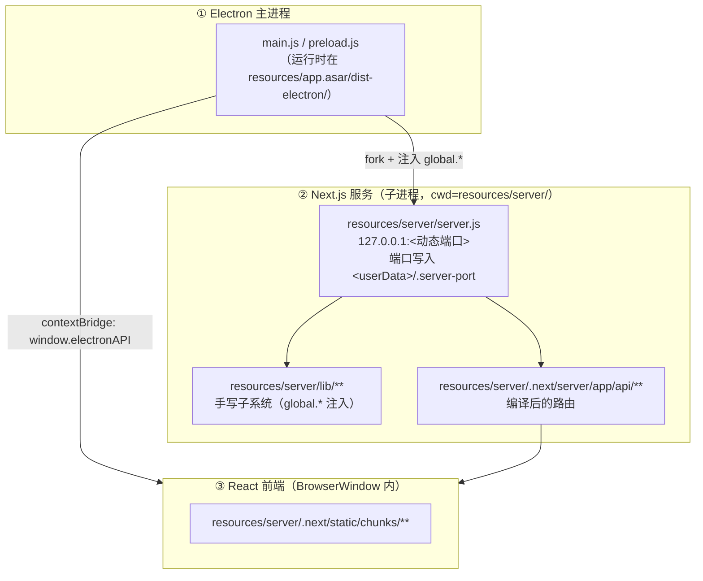

# Socratopia 总文档（MASTER）

> 本文是**导航 + 状态**，不复制专题细节：每个专题给出「一句话 + 去哪看原文」。
> 工作区：`E:\huanjing\sogeladi\Socratopia`　分支：`codex/push`　HEAD：`1f2ad2d`（2026-10-22 15:30）　最近更新：2026-11-03
> 面向两类读者：**想了解全貌的人**（本文）；**要动手改代码的 agent**（[`../CLAUDE.md`](../CLAUDE.md) 与 [`../AGENTS.md`](../AGENTS.md) 是工作契约，不重复）。

---

## 0. 三分钟上手

| 你想知道的 | 去哪儿 |
|---|---|
| 这个仓库到底是什么形态、为什么这么怪 | [§1 仓库形态](#1-仓库形态) · [`../README.md`](../README.md) |
| 怎么启动、怎么改、怎么验证 | [§2 四张命令卡](#2-四张命令卡) · [`../AGENTS.md`](../AGENTS.md#exact-commands) |
| 某个功能做没做完、文档在哪 | [§3 功能专题索引](#3-功能专题索引) |
| 项目历史、22 个 BUG、技术债 | [§4 项目史与 BUG](#4-项目史与-bug-台账) |
| 素材、数据集、取证档案的边界 | [§5 数据与内容资产](#5-数据与内容资产) |
| 密钥会不会漏、仓库是不是公开的 | [§6 安全与密钥边界](#6-安全与密钥边界) |
| 临时文件往哪放、多久清一次 | [§7 仓库卫生](#7-仓库卫生) |
| 全部文档在哪、是什么状态 | [§8 文档地图](#8-文档地图) |
| 现在手上没做完的事 | [§9 当前工作状态](#9-当前工作状态) |
| **十月/十一月做了什么** | [`reviews/2026-10-11-编码回顾.md`](reviews/2026-10-11-编码回顾.md) |
| **十月/十一月有什么漏洞** | [`reviews/2026-11-漏洞筛查与点评.md`](reviews/2026-11-漏洞筛查与点评.md) |
| **仓库整理动了什么** | [`reviews/2026-11-仓库整理执行记录.md`](reviews/2026-11-仓库整理执行记录.md) |

---

## 1. 仓库形态

**一句话**：这是 Socratopia 的**打包产物仓库**，不是可编译的源码树。

- 没有构建流水线会从源码重新生成 bundle；所有改动都是对编译产物（webpack/esbuild 输出）的**外科式补丁**，靠 `node --check` / acorn + 就地冒烟测试验证。
- 唯一可以当普通源码编辑的：`resources/server/server.js` 与 `resources/server/lib/**`（93 个顶层文件 + 15 个子系统目录）。
- 根目录 `main.js` / `preload.js` 是 Electron 层的**工作副本**，运行时的真身在 `resources/app.asar` 里。
- 上游源码仓库是 macOS 的 `socralab-app/v2`；Windows 侧的工作副本在 `E:\huanjing\sogeladi\Socratopia_2.0\Socratopia`（改生代码前先 diff）。

### 三层架构



- `server.js:881-900` 的模块表把子系统挂到 `global.*`；编译产物无法 `require()` 的模块只能从那里取（新增模块要加一行表）。
- `.next/server/chunks/*.js` **不能** `require("fs")`，只能用 `global.__FS__`；路由文件 `app/api/*/route.js` 可以。
- 鉴权：除 `/api/account/init` 外，路由通过 `lib/route-auth.js` + `lib/local-request-auth.js` 的**能力令牌门面**（fail-closed）；受保护路由清单与实测口径见 [`reviews/2026-11-漏洞筛查与点评.md`](reviews/2026-11-漏洞筛查与点评.md) §3.5。

---

## 2. 四张命令卡

```powershell
# 启动
./Socratopia.exe

# 语法检查（改过任何 .js 都跑）
node --check <file>
node -e "require('acorn').parse(require('fs').readFileSync('<file>','utf8'),{ecmaVersion:2022})"   # 精确定位语法错

# 冒烟测试（自包含，无依赖、无需启动应用）
node <模块旁的 *-smoke-test.js>
node tools/run-smoke-matrix.js                       # 批量；注意它跳过 .next/ 与 tools/
node resources/server/.next/server/app/api/chat/chat-end-class-integration-smoke-test.js   # .next/ 里的要手跑

# 重打包（改了 Electron 层）
node tools/finish-asar-repack.js                     # 一条龙：同步→打包→重嵌 ELECTRONASAR
node tools/patch-asar-integrity.js --check           # 只校验
```

| 改什么 | 改哪里 | 之后要做什么 |
|---|---|---|
| API 路由逻辑 | `resources/server/.next/server/app/api/*/route.js` | `node --check`；改了路由集合要同步三份 manifest |
| 共享服务逻辑 | `resources/server/lib/*.js`（手写）或 `.next/server/chunks/*.js` | 同上；chunk 内禁用 `require("fs")`；改 LLM 核心要改全部 6 份 definer（模块 `64092`） |
| 前端 | `resources/server/.next/static/chunks/**/*.js` | `node --check` |
| Electron 主进程 / preload | 根 `main.js`、`preload.js` | 重新打包 ASAR + 重嵌完整性哈希（**EXE 被占用时会静默产出不匹配的一对**） |

---

## 3. 功能专题索引

| 功能 | 状态 | 权威文档 | 主要代码位置 |
|---|---|---|---|
| 苏格拉底式课堂主链（问答、下课交接） | 已交付 | `docs/project-reconstruction/02-module-dossiers/classroom-main-chain.md` | `app/api/chat/`、模块 64092 |
| 自适应教学（诊断、知识图谱、练习编排） | 已交付 | `ADAPTIVE_TEACHING_MODE_TECHNICAL_REPORT.md`、`方案.md` | `lib/adaptive/`（32 文件） |
| 知识源（知识库构建/发布/质量） | 已交付 | `docs/project-reconstruction/02-module-dossiers/knowledge-source-provider.md` | `lib/knowledge/`、`lib/kb-*.js` |
| 图像资产层 P0（落盘/索引/序列化/接口/截图） | 已交付并被复用 | `IMAGE_ASSET_LAYER_P0_COMPLETION_REPORT.md`、`IMAGE_ASSET_LAYER_P0_ACCEPTANCE_REVIEW.md` | `lib/assets/`（20 文件）、`public/asset-capture.js` |
| 图像资产层 T13（页渲染/几何裁图/下单契约） | **部分休眠**：几何裁图约 640 行靠 `assets.boxMode="off"` 兜底；仅保留 AI 自绘 SVG | `IMAGE_ASSET_LAYER_T13_COMPLETION_REPORT.md`（§13–§14、§16） | `lib/pdf-page-render.js`、`lib/assets/{locate-figure,figure-box,figure-ink,page-lines}.js` |
| 选段朗读 + 教学节奏 | **未收口**（2026-10-23 起 12 项工作区改动） | `docs/selection-dock-teaching-pace/DESIGN.md` | `public/selection-dock.js`、`lib/adaptive/teaching-pace.js`、`lib/textbook-text-index.js`（未跟踪） |
| OCR 管线（教材页识别、质量判定、批量缓存） | 已交付 | `OCR_DEADLINE_LIVELOCK_AND_STREAM_LEAK_FIX.md` | `lib/ocr/`（16 文件）、`lib/pdf-ocr-coordinator.js` |
| 自动翻页（阅读窗口推进） | 已交付 | `AUTO_ADVANCE_WINDOW_REPAIR_CHANGELOG.md`、`AUTO_ADVANCE_PAGE_ONLY_STALL_FIX_PLAN.md` | `lib/adaptive/`、`lib/reading/` |
| 数学公式语义化朗读 | 已交付 | `MATH_SPEECH_CORE_{DEVELOPMENT_SPEC,ACCEPTANCE_SPEC,COMPLETION_REPORT}.md` | `lib/math-speech/`（27 文件） |
| TTS / 内联朗读协议 | 已交付 | `TTS_OPTIMIZATION_CHANGELOG.md`、`SAY_INLINE_SPEECH_PROTOCOL_CHANGELOG.md` | `lib/voice-*` |
| 课后笔记（保存可靠性/质量） | 已交付 | `POST_CLASS_SAVE_FIX_2026-09-13.md`、`POST_CLASS_NOTES_QUALITY_RELIABILITY_DEVELOPMENT_PLAN.md` | `lib/post-class-notes/`（17 文件） |
| 练习（practice） | 已交付 | `PRACTICE_FEATURE_TECHNICAL_PLAN_AND_CLAUDE_PROMPTS.md` | `lib/practice/`（13 文件） |
| 课堂上下文（DeepSeek V4 Flash） | 已交付 | `DEEPSEEK_V4_FLASH_CLASSROOM_{PLAN,IMPLEMENTATION_CHECKLIST,ACCEPTANCE}.md` | `lib/close-reading/`（16 文件） |
| LLM 成本与缓存治理 | 已交付（2026-10-22） | `docs/llm-cost-and-cache-optimization.md` | `lib/model-router.js`、`lib/llm-gateway.js`、`lib/responses-api-compat.js` |
| thinking 门控 | 已交付 | `LLM_THINKING_FIX_CHANGELOG.md` | `lib/reasoning/`（17 文件） |
| 聊天软删除（可恢复） | 已交付 | — | `lib/chat-trash.js` |
| Agent 评测任务包（T1/T3/T4） | 已交付 | `agent-task-datasets/`（含评分方锚点答案） | 数据集（LFS） |

---

## 4. 项目史与 BUG 台账

| 主题 | 位置 |
|---|---|
| 项目地图 | `docs/project-reconstruction/00-phase-a-project-map.md` |
| 产品愿景与演进 | `docs/project-reconstruction/01-product-vision-and-evolution.md` |
| 模块档案（9 篇） | `docs/project-reconstruction/02-module-dossiers/` |
| 时间线 | `docs/project-reconstruction/03-timeline.md` |
| **BUG 台账（22 个，含证据与复现）** | `docs/project-reconstruction/04-bug-ledger.md` |
| 技术债与风险 | `docs/project-reconstruction/05-tech-debt-and-risks.md` |
| 重构路线 | `docs/project-reconstruction/06-refactor-roadmap.md` |
| 旧文档分级 | `docs/project-reconstruction/07-legacy-docs-assessment.md` |
| 本分支 vs 本体边界 | `docs/project-reconstruction/09-original-vs-branch-boundary.md` |
| 验证基线 | `docs/project-reconstruction/10-verification-baseline.md` |
| 实机冒烟记录 | `docs/project-reconstruction/13-live-e2e-smoke.md` |
| 决策记录 / 证据 / 清单 / 开放问题 | `docs/project-reconstruction/{DECISIONS,EVIDENCE,INVENTORY,OPEN-QUESTIONS}.md` |
| **十月—十一月复盘** | `docs/reviews/2026-10-11-编码回顾.md` |

---

## 5. 数据与内容资产

| 资产 | 位置 | 约束 |
|---|---|---|
| 世界设定取证档案（44 个来源：原文 HTML + 抽取文本 + 索引） | `资料/` | `资料/索引/下载清单.json` 按 **LF 字节**钉死 SHA-256；`.gitattributes` 已对 `资料/来源原文/**`、`资料/可用文本/**` 关闭换行转换，**不要"修"行尾** |
| 角色设定、人设模板、立绘（32 个） | `角色/` | 入库 |
| 只读种子内容（世界预设、候选头像） | `resources/bundled-content/{zh,en,zh-TW}/initial_world/` | **只读**；世界 lore 卡片发布 home 在 `resources/bundled-content/<lang>/world-lore/<canon>/` |
| Agent 评测任务包 | `agent-task-datasets/` | `**/chats/*.json` 走 **Git LFS**（有两个 99 MB / 121 MB 的对话档，超 GitHub 单文件上限）；克隆前先装 `git lfs` |
| 数学语音项目档案 | `PROJECT_MATH_SPEECH_DOSSIER/` | 与 `MATH_SPEECH_CORE_*` 互链，不合并 |
| 发布快照 | `win-unpacked/` | **被跟踪**的旧发布版，**不自动同步**；刷新要手工 stage + 镜像；`settings.json`/`set.json` 需手工回填 |
| 用户运行数据 | `%APPDATA%/socratopia/project-data` | 账号维度：`accounts/<accountId>/profiles/<pid>/worlds/<wid>/`；**永不入库** |

---

## 6. 安全与密钥边界

| 规则 | 状态（2026-11-03 取证） |
|---|---|
| `resources/settings.json`（端点 + API key）、`resources/set.json`（角色→模型）**绝不入库** | `.gitignore` 逐条实测覆盖（含 `settings*.json` / `set*.json` 模式与 `win-unpacked/` 副本） |
| 历史里有没有密钥？ | **没有**。`git log --all -- resources/settings.json resources/set.json` 为 0 命中；全历史对象扫描只有 2 个无关 lore 卡片；`sk-*` 形态只命中测试夹具（`task-isolation-smoke-test` 等） |
| 这个仓库公开了吗？ | **公开**。`origin = https://github.com/sun-niming/Socratopia.git`，GitHub API 返回 `"private":false`（创建 2026-10-19，最近推送 2026-10-22） |
| `resources/rules/*`、用户数据、`app.asar` | 不入库（例外：`rules_zh_classroom_compact.md` 入库） |
| 能力令牌与账号域 | `lib/route-auth.js` + `lib/local-request-auth.js`：**fail-closed**（缺 verifier ⇒ 503 `auth_unavailable`；缺头 ⇒ 401 `auth_missing`），账号域由 `assertAccountScope` 校验 |
| 已知安全发现 | 见 [`reviews/2026-11-漏洞筛查与点评.md`](reviews/2026-11-漏洞筛查与点评.md)：**2 条高危**（渲染层 XSS 及其特权提权）、6 条中危、6 条低危/观察项 |

> 提醒：`win-unpacked/resources/{settings,set}.json` 需要**手工回填**且含 live key，**整目录复制/打包时注意别带出去**。

---

## 7. 仓库卫生

| 约定 | 内容 |
|---|---|
| 临时产物放哪 | `tmp/`（工具与实验现场）或 `outputs/`（交付物与个人材料），两者都被 `.gitignore` 覆盖 |
| 大文件放哪 | `agent-task-datasets/`（LFS）或 `资料/`；单文件超 100 MB 会被 GitHub 拒收 |
| 清理节奏 | 每轮复盘先量 `du`，再按「可再生 → 唯一副本 → 用户数据」三档分级；**唯一副本先转移再删**（2026-11-03 的执行范例见 [`reviews/2026-11-仓库整理执行记录.md`](reviews/2026-11-仓库整理执行记录.md)） |
| 当前占用 | `outputs/` 2 293 MB（用户备份 2 132 MB 待确认）、`resources/` 879 MB、`tmp/` 792 MB、`win-unpacked/` 548 MB、`.git` 457 MB |
| 待处理 | `outputs/account-backups/`（2.1 GB，可能是唯一副本）、个人求职材料、团队课程项目唯一副本 —— 均**待用户确认后移出仓库** |
| 永久保留 | `tools/gateway-monitor/`（AGENTS.md 明令）、`资料/`、`角色/`、`agent-task-datasets/`、`docs/`、`resources/`、`win-unpacked/` |

---

## 8. 文档地图

### 8.1 根目录 27 份（专题权威原文）

| 分组 | 文件 | 状态 |
|---|---|---|
| 入门 | `README.md`、`CLAUDE.md`、`AGENTS.md` | 现行；`CLAUDE.md` 的远端/密钥两句已于 2026-11-03 修正 |
| 图像资产层 | `IMAGE_ASSET_LAYER_PLAN.md`、`_P0_COMPLETION_REPORT.md`、`_P0_ACCEPTANCE_REVIEW.md`、`_T13_PLAN.md`、`_T13_COMPLETION_REPORT.md` | 现行（T13 报告 52 KB 是最新权威） |
| 自适应教学 | `ADAPTIVE_TEACHING_MODE_TECHNICAL_REPORT.md`、`方案.md` | 历史资料 + 现行计划 |
| 数学语音 | `MATH_SPEECH_CORE_DEVELOPMENT_SPEC.md`、`_ACCEPTANCE_SPEC.md`、`_COMPLETION_REPORT.md` | 现行（模块文档最全） |
| 课堂上下文 | `DEEPSEEK_V4_FLASH_CLASSROOM_CONTEXT_PLAN.md`、`_IMPLEMENTATION_CHECKLIST.md`、`_ACCEPTANCE.md` | 现行（建议合并为一份带时间线的专题） |
| OCR | `OCR_DEADLINE_LIVELOCK_AND_STREAM_LEAK_FIX.md` | 现行 |
| 自动翻页 | `AUTO_ADVANCE_WINDOW_REPAIR_CHANGELOG.md`、`AUTO_ADVANCE_PAGE_ONLY_STALL_FIX_PLAN.md` | 现行 |
| TTS / 语音 | `TTS_OPTIMIZATION_CHANGELOG.md`、`SAY_INLINE_SPEECH_PROTOCOL_CHANGELOG.md`、`VOICE_MODEL_MAPPING_REPORT.md` | 前两份现行；`VOICE_MODEL_MAPPING_REPORT.md` 是 2026-06-05 的历史调查 |
| LLM | `LLM_THINKING_FIX_CHANGELOG.md` | 现行 |
| 课后笔记 | `POST_CLASS_SAVE_FIX_2026-09-13.md`、`POST_CLASS_NOTES_QUALITY_RELIABILITY_DEVELOPMENT_PLAN.md` | 现行 |
| 练习 | `PRACTICE_FEATURE_TECHNICAL_PLAN_AND_CLAUDE_PROMPTS.md` | 历史 + 部分有效 |
| 已处置 | `上下文.md` | 与项目无关，疑似误放 —— **2026-11-03 已移至 [`docs/external/webserver-homework-context.md`](external/webserver-homework-context.md)**（见 [`docs/external/README.md`](external/README.md)） |

### 8.2 `docs/`（43 份）

| 位置 | 内容 |
|---|---|
| `docs/llm-cost-and-cache-optimization.md` | 账单反解与缓存命中率优化（2026-10-22） |
| `docs/project-reconstruction/` | 项目史与证据层：`00` 项目地图 → `19` 逐个 BUG 修复 → `DECISIONS/EVIDENCE/INVENTORY/OPEN-QUESTIONS/WORKSTATE/RESUME/README`，另有 `02-module-dossiers/`（9 篇）与 `recovered/`（历史找回） |
| `docs/selection-dock-teaching-pace/DESIGN.md` | 选段朗读 + 教学节奏设计（**当前未收口功能的设计文档**） |
| `docs/reviews/` | **本轮新增**：`2026-10-月度改动清单.md`（十月逐条）、`2026-10-11-编码回顾.md`（跨月复盘）、`2026-11-漏洞筛查与点评.md`（安全筛查）、`2026-11-仓库整理执行记录.md`（整理动作）、`仓库整理盘点与方案.md`（只读盘点） |
| `docs/external/` | **本轮新增**：与本项目无关但曾被误提交进仓库根的材料（`webserver-homework-context.md`），保留是为了不断掉证据台账的取证链；见该目录 README |

---

## 9. 当前工作状态（2026-11-03）

| # | 事项 | 体量 | 状态 | 优先级 |
|---|---|---|---|---|
| 1 | 选段朗读 + 教学节奏（12 项未提交改动，含未跟踪模块 `lib/textbook-text-index.js`） | +940 −125 | 无验收记录、未提交 | **最高**（收口前先修 XSS） |
| 2 | 渲染层 XSS 与其特权提权（V-01 / V-02） | — | 已定位，未修 | **最高** |
| 3 | 图层 640 行休眠机器的"复活 or 删除"判定 | 640 行 | 未决 | 中 |
| 4 | 鉴权契约测试漏掉 chat / groupchat（V-05） | — | 已定位 | 中 |
| 5 | 资产层 SVG 两套校验标准 + 响应头（V-03/V-04） | — | 已定位 | 中 |
| 6 | 教材冷提取放大面（V-06） | — | 已定位 | 中 |
| 7 | 文档漂移（V-07 三处） | — | ①③已改 CLAUDE.md；②已改 README；①的措辞建议改为「以活探针为准」 | 低 |
| 8 | 公开仓库的跟踪文件卫生（`ax.jpg`、`pelican-bicycle-animation.html`、`profiles/`、`上下文.md`） | 4 处 | **本轮已取消跟踪/移位**；历史里的 blob 仍在，彻底清除需 `git filter-repo` + 强推（**待你点头**） | 中 |
| 9 | `outputs/` 用户备份 2.1 GB / 个人材料 / 团队课程唯一副本 | 2.2 GB+ | **待用户确认** | 待定 |
| 10 | 提交与推送策略：本轮全部改动仍只在本地工作区 | — | 未 commit、未 push | 中 |

> 验证基线（2026-11-03）：`node tools/run-smoke-matrix.js` ⇒ **149 项 / 147 通过 / 0 失败 / 2 跳过**（跳过的两项是需实机夹具的 `pdf-cmap-real`、`pdf-render-real`）。

---

*本文档随每次复盘更新；细节以链接的专题原文为准。*
