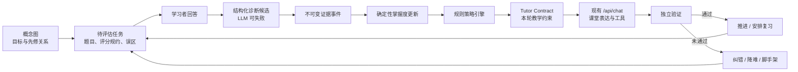
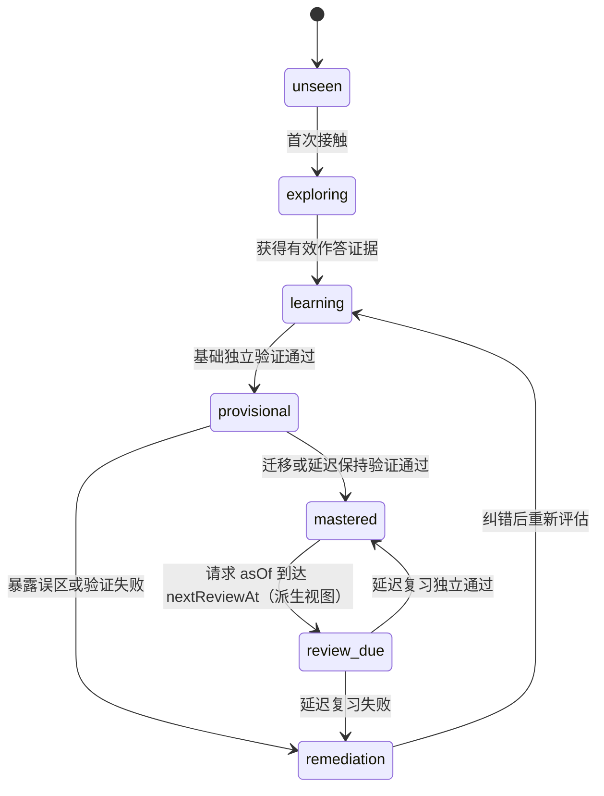
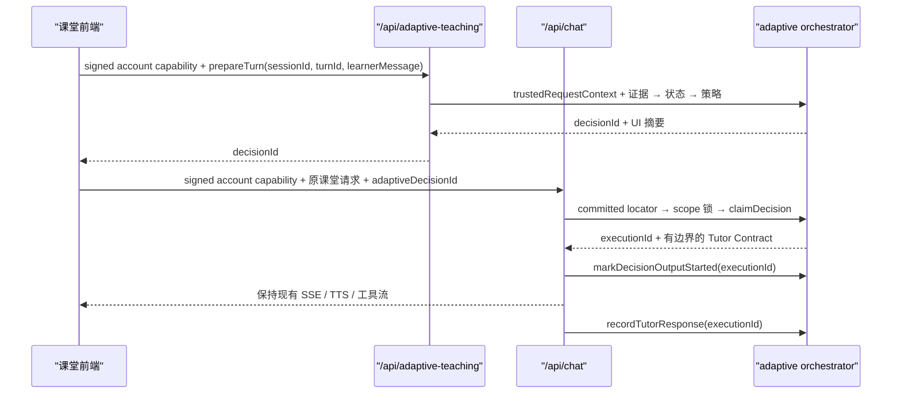

# Socratopia 自适应教学闭环实现方案

> 文档状态：待审批方案，尚未执行代码改造  
> 目标版本：当前 Windows 打包产物（Electron + Next.js）  
> 编写日期：2026-08-19  
> 首次建议审批范围：仅 Stage A——后端闭环内核

## 1. 结论

自适应教学在当前 Socratopia 中是可行的，但它不应被实现成“让多个大模型自由讨论后决定怎么教”，而应被实现成一个可审计、可回放、可降级的教学控制闭环：

1. 概念图定义“要学什么”和先修关系。
2. 评估题产生可验证的学习证据。
3. 大模型只负责提出结构化诊断候选，不直接修改掌握度。
4. 确定性代码根据证据更新学习状态。
5. 规则策略选择下一步教学动作。
6. 现有 `/api/chat` 继续负责课堂表达、角色、流式输出、语音和工具调用。
7. 每次“学会”都必须经过独立作答、迁移题或延迟复习验证。

推荐先实现一个不接入前端、不改变现有课堂行为的后端闭环内核。Stage A 通过全部验收场景后，再决定是否进入课堂实验。

## 2. 当前系统基线

### 2.1 三层运行结构

| 层级 | 当前入口 | 职责 |
| --- | --- | --- |
| Electron 主进程 | `main.js`、`preload.js` | 启动 Next.js、窗口和原生能力 |
| Next.js 服务端 | `resources/server/server.js` | 配置、服务注册、API 运行环境 |
| React 前端 | `resources/server/.next/static/chunks/**/*.js` | 课堂、练习、闪卡等用户交互 |

### 2.2 已有可复用能力

| 能力 | 位置 | 当前状态 |
| --- | --- | --- |
| 自适应数据层 | `resources/server/lib/adaptive/data-layer.js` | 已存在，但路径不是完整的 account-aware 模型 |
| 概念图构建 | `resources/server/lib/adaptive/concept-graph-builder.js` | 已实现并有冒烟测试 |
| 学习诊断 | `resources/server/lib/adaptive/diagnostician.js` | 已实现并有冒烟测试 |
| 概念图 API | `/api/adaptive-concept-graph` | 已实现 |
| 诊断 API | `/api/adaptive-diagnosis` | 已实现 |
| 自适应教学 API | `/api/adaptive-teaching` | 当前仅为注册/回显桩，未形成闭环 |
| 课堂编排 | `/api/chat` | 已承载人设、教材、工具、SSE、TTS、进度、精读和结课写入 |
| 练习与闪卡 | Practice、Flashcard | 可在后续提供高质量外部学习证据 |

### 2.3 当前关键缺口

1. 前端没有调用任何 adaptive API，自适应能力没有进入真实课堂数据流。
2. 现有概念图与诊断是分散能力，没有会话、证据、状态更新和下一步策略。
3. 当前自适应数据使用全局目录，可能造成不同账号之间的数据边界不清晰。
4. 诊断结果没有被限制为“建议”，存在未来被错误用作掌握度事实的风险。
5. “学生说懂了”“大模型觉得答得不错”和“真正掌握”之间尚无证据分级。
6. 没有幂等、并发串行、决策回放和失败降级契约。
7. 当前账号 helper 只校验客户端可提交的 `X-Account-Id`/query，不能称为已认证账号上下文。打包 Electron 已通过 child env 注入 `HOSTNAME=127.0.0.1`，但 `server.js` 独立启动的 fallback 仍是 `0.0.0.0`，且任一本机调用者仍可伪造账号头；在建立不可伪造的本地桌面 capability 前，新的自适应 HTTP 写入面不能对普通请求启用。

## 3. 设计目标与非目标

### 3.1 设计目标

- 建立从教学目标到独立验证的完整闭环。
- 将长期学习状态建立在不可变证据之上，而非自由文本判断之上。
- 保留现有 `/api/chat` 的课堂能力，不复制一套聊天系统。
- 隔离账号、档案、世界、教材和会话数据。
- 每次状态变化都能回答：由哪条证据、哪条规则、哪个版本产生。
- 自适应服务失败时，普通课堂仍可正常工作。
- 先以默认关闭的实验能力上线，经过验证后再扩大作用范围。
- 对账号命名空间、请求调用者和文件系统身份分别建模：raw header 不是认证，Windows 路径别名不是不同 scope，锁键必须与实际落盘身份一致。

### 3.2 非目标

- Stage A 不修改前端、不修改 `/api/chat`，也不改变当前课堂行为。
- 不让大模型直接读写 `masteryScore` 或把概念标记为 `mastered`。
- 不重写现有模型核心，不修改重复分布在 8 个 bundle 中的模块 `64092`。
- 不把群聊、日记、总结、精读次数或“我理解了”当作掌握证据。
- 不在第一阶段实现复杂强化学习、黑盒推荐或多智能体自治。
- 不自动删除或破坏旧版 `adaptive-teaching` 数据。

## 4. 闭环总体结构



闭环中最重要的信任边界是：

```text
LLM 诊断 = 候选解释
观察事件 = 发生过的作答、提示和诊断记录
已验证证据 = 经过独立评分权威确认的观察事件
掌握状态 = 确定性规则仅从已验证证据推导出的结果
策略决策 = 可解释规则给出的下一步动作
```

## 5. 证据体系

### 5.1 可以影响掌握度的已验证证据

| 证据 | 最低验证条件 | 可信度 | MVP 建议增量 |
| --- | --- | --- | ---: |
| 独立完成基础题 | 确定性评分器通过 | 中 | `+0.10` |
| 独立完成迁移题 | 确定性评分器或第二次独立评估通过 | 高 | `+0.18` |
| 轻提示后答对 | 确定性评分器通过并记录提示级别 | 低到中 | `+0.05` |
| 重提示后答对 | 确定性评分器通过并记录提示级别 | 很低 | `+0.01` |
| 独立答错 | 确定性评分器确认 | 中 | `-0.10` |
| 重复出现同一误区 | 规则命中已知错误模式，或多次独立评估交叉确认 | 高 | `-0.15` |
| 仅表达“我理解了” | 无法验证 | 无 | `0` |
| 延迟复习独立答对 | 服务端确定性评分通过 | 很高 | `+0.20` |

这些数值是 MVP 初始规则，不是永久结论。每次事件的增减必须设上限，并通过真实学习结果校准。

### 5.2 只可作为上下文、不可证明掌握的信号

- “我懂了”“继续”“这个很简单”等自我报告。
- 教师角色或诊断模型生成的主观评价。
- 群聊参与、日记内容和概念总结。
- 阅读过某段教材或完成一次精读。
- 单纯的响应长度、停留时间和对话轮数。

这些信号可用于选择语气、触发检查题或调整节奏，但不能直接提升长期掌握状态。

### 5.3 评分权威与验证门控

“结构化 JSON”和“高置信度”都不能把 LLM 判断变成事实。每个 assessment 必须在创建时声明 `scoringMode`，评分权威按以下规则确定：

| 题目或信号 | `scoringMode` | 评分权威 | 是否可直接形成长期证据 |
| --- | --- | --- | --- |
| 选择、判断、排序、固定集合 | `deterministic` | 已验证答案键 + assessment engine 的规则 | 仅答案键 provenance 已验证时 |
| 数值、公式、受限短答 | `deterministic` | 已验证答案键 + 规范化、容差、等价规则 | 仅答案键 provenance 已验证时 |
| 开放解释、论证、迁移表达 | `llm_assisted` | LLM 仅提出诊断候选 | 否，先记为 `unverified` |
| 自我报告 | `self_report` | 无评分权威 | 否，权重固定为 0 |
| Practice 服务端评分 | `external_deterministic` | 已版本化的 Practice 服务端评分器 | 仅来源契约验证通过时 |
| Flashcard 延迟回忆 | `external_deterministic` | 已验证答案键的服务端比对或独立回忆题 | 仅来源契约验证通过时；自评除外 |

#### 答案键信任链

“确定性”只表示同一输入会得到同一评分，并不证明答案键在语义上正确。每个 assessment 必须同时保存：

```js
{
  assessmentVersion,
  generatorType: "template | solver | llm | external",
  sourceRefs: [{
    sourceId,
    pageOrCardId,
    contentHash,
    excerptHash
  }],
  answerKey,
  answerKeyHash,
  answerKeyProvenance: "source_anchored | solver_derived | human_verified | external_verified | llm_generated",
  answerKeyValidationStatus: "unverified | verified | rejected",
  validatorType: "template_rule | solver | human | external_contract | none",
  validatorVersion
}
```

答案键验证规则：

1. `source_anchored` 只适用于由固定模板从带 hash 的教材原文或结构化 KB 字段直接生成的问题和答案；LLM 改写或推断出的答案不属于此类。
2. `solver_derived` 必须保存规范化输入、求解器名称/版本和可重放结果。
3. `human_verified` 必须保存显式审核记录；`external_verified` 必须通过版本化服务端契约。
4. 现有 concept graph 中由 LLM 生成的 `expectedAnswer/rubric` 一律先标记为 `llm_generated/unverified`，不能因为之后使用确定性字符串比较就升级为评分权威。
5. 第二个 LLM、同一生成器的另一道题或相同未验证答案键不构成独立验证。
6. 只有 `answerKeyValidationStatus === "verified"` 的 assessment 才能产生 verified evidence；否则作答结果保持 `unverified`。
7. evidence 和 transaction payload 必须记录 `assessmentVersion + answerKeyHash + validatorVersion`，防止答案键变更后无法回放。

开放题的处理流程：

1. diagnostician 输出候选 verdict、误区和置信度，只创建 `unverified` 观察事件。
2. policy engine 根据候选诊断选择一条新的独立检查题，优先使用可确定性评分的题型。
3. 独立检查通过后，新增一条 `verified` 证据，并通过 `verifiedByEventIds` 关联原观察；不修改原事件。
4. 独立检查失败时，新增失败证据并进入纠错；不能把原 LLM 候选升级为正确。
5. 若概念无法生成带 verified answer key 的检查题，则只能等待 human/external verified 或带已验证答案键的延迟评估；第二个 LLM 判断、同一生成器的另一题都不能形成长期证据。

`diagnosticConfidence` 只影响“下一步检查的优先级”，不能把 `unverified` 自动升级成 `verified`。LLM 误判无论置信度高低，都不能直接产生正向或负向长期状态变化。

### 5.4 证据事件契约

每条观察或证据作为只追加、不可就地改写的事件保存，至少包含：

```js
{
  schemaVersion: 1,
  eventId: "稳定且可幂等的事件 ID",
  eventKey: "独立于 requestId 的领域事件键",
  eventInputHash,
  transactionId,
  accountId,
  profileId,
  worldId,
  textbookId,
  sessionId,
  turnId,
  conceptId,
  source: "classroom | practice | flashcard",
  evidenceType: "basic | transfer | misconception | retention | self_report",
  outcome: "correct | incorrect | unknown",
  assistanceLevel: "none | light | heavy",
  verificationStatus: "unverified | verified | rejected",
  graderType: "deterministic | llm_assisted | self_report | external_deterministic",
  graderVersion,
  assessmentVersion,
  answerKeyHash,
  answerKeyProvenance,
  validatorVersion,
  diagnosticConfidence: 0.0,
  verifiedByEventIds: [],
  sourceEventId,
  createdAt,
  payloadHash
}
```

约束：

- `eventKey` 必须由领域身份稳定生成：课堂事件至少包含 scope、sessionId、turnId 和 assessmentId，外部事件至少包含 scope、source 和 sourceEventId；它不能依赖 requestId。
- 同一 `eventKey` 且 `eventInputHash` 相同只能指向原事务并恰好计分一次；同一 eventKey 输入 hash 不同必须返回 `409 evidence_conflict`，不能覆盖或再次计分。
- 原始自由文本可以保留引用或摘要，但状态引擎只读取经过校验的枚举字段。
- mastery engine 只接受 `verificationStatus === "verified"`、评分权威符合 assessment 契约且答案键本身已 verified 的事件。
- 每条事件必须携带 transactionId；物化投影只读取其 transaction 状态为 `committed` 的事件。
- LLM 辅助诊断、LLM 生成答案键无论置信度高低都只能产生 `unverified` 记录。
- 评分器、assessment、answerKeyHash、validatorVersion 和 transactionId 必须进入事件及 `payloadHash`，保证回放结果可解释。
- `payloadHash` 统一对移除 `payloadHash` 自身字段后的 canonical JSON 计算；对象键排序、数组顺序、数字和 Unicode 规范必须版本化，禁止对包含自身 hash 的对象直接递归求 hash。
- 事件写入后不修改；需要纠正时追加补偿事件。

## 6. 概念状态与转移规则

### 6.1 状态机



### 6.2 硬约束

1. 没有独立成功证据，不得进入 `mastered`。
2. 自我报告不得进入 `provisional`，只触发检查题。
3. 重提示后答对不能被记为独立掌握。
4. `mastered` 必须至少包含迁移证据或延迟保持证据。
5. 任何 `unverified`、`rejected` 或评分权威不匹配的事件都不得改变长期状态。
6. LLM 诊断不能直接形成正向或负向长期证据，置信度不构成例外。
7. 低置信度、解析失败或超时的诊断只能触发保守检查。
8. 单个事件对分数和状态的影响必须有上限。
9. 先修概念未达到最低门槛时，不推进依赖概念的高难任务。
10. 所有转移同时保存 `reasonCodes`、输入事件 ID、评分器版本和规则版本。
11. ledger 重放得到的持久化 mastery projection 只保存证据决定的基础状态与 `nextReviewAt`；`review_due` 是按一次请求固定的 `evaluationTime/asOf` 派生出的 effective state，不进入 ledger-derived projection hash。
12. policy、assessment 和决策生成只能使用事务开始时捕获并写入 journal 的同一个 `evaluationTime`；幂等重放复用原值，禁止恢复时重新读取当前时钟改变既有结果。

掌握分数只用于排序和辅助判断，不作为唯一门槛。状态晋级还必须满足证据种类、独立性和时间条件。对读取端展示的 `effectiveState`，`baseState === "mastered" && evaluationTime >= nextReviewAt` 时可显示为 `review_due`；该时间派生值不得反向污染可重放投影。

## 7. 策略引擎

策略引擎使用确定性规则，不调用 LLM。建议按以下优先级选择下一动作：

1. 当前存在未完成评估：继续该评估，避免一轮生成多个互相冲突的问题。
2. 学生只表达理解、没有证据：发出短检查题。
3. 同一误区重复出现：进入 `remediate_misconception`，降低难度并换一种解释。
4. 重提示后才答对：发出同构但不同表面的独立题。
5. 基础题独立通过但缺少迁移证据：选择 `assess_transfer`。
6. 概念达到晋级条件：选择 `advance`，并安排复习。
7. 有到期复习：优先 `review_due`。
8. 先修知识不足：回退到最小缺口概念。
9. 没有可用诊断或外部服务超时：保持当前概念，使用保守检查或退回普通课堂。

策略输出不是一段任意提示词，而是结构化决策：

```js
{
  decisionId,
  sessionId,
  conceptId,
  action: "check | explain | remediate | assess_transfer | advance | review",
  difficulty: "lower | same | higher",
  reasonCodes: ["SELF_REPORT_NEEDS_CHECK"],
  assessmentId,
  tutorContract: {
    objective,
    requiredMove,
    forbiddenMoves,
    hintLevel,
    expectedEvidenceType,
    maxQuestions: 1
  },
  rulesVersion,
  createdAt
}
```

## 8. 模块体系

### 8.1 新增服务端模块

| 文件 | 单一职责 | 主要输入/输出 |
| --- | --- | --- |
| `resources/server/lib/local-request-auth.js` | 校验短期、签名且绑定 accountId/audience/sessionEpoch 的本地桌面 capability，并匹配由父进程同步的当前 auth state；拒绝 raw account header 充当认证 | HTTP 请求 → trustedRequestContext 或显式拒绝 |
| `resources/server/lib/llm-gateway.js` | 统一自适应模块的模型调用、超时、JSON 校验和错误分类 | 结构化请求 → 结构化结果或显式错误 |
| `resources/server/lib/adaptive/storage-v2.js` | account-aware 路径、单文件原子写、版本读取和非破坏迁移 | 领域对象 ↔ 文件 |
| `resources/server/lib/adaptive/evidence-ledger.js` | 观察/证据校验、验证状态、幂等追加和重放查询 | 原始结果 → 不可变事件流 |
| `resources/server/lib/adaptive/mastery-engine.js` | 仅从已验证证据计算掌握投影和状态转移 | 旧投影 + 已验证证据 → 新投影 + 原因 |
| `resources/server/lib/adaptive/policy-engine.js` | 确定性选择下一教学动作 | 学习状态 + 待办 → 决策草案 |
| `resources/server/lib/adaptive/assessment-engine.js` | 管理题目、答案键 provenance/验证、评分规约、确定性评分器、误区和提示级别 | 概念 + 目标/回答 → 评估对象/评分结果 |
| `resources/server/lib/adaptive/transaction-journal.js` | request/result hash、完整 write payload、prospective 校验、commit marker、mutable CAS/物化和崩溃恢复 | durable write set ↔ 已提交事务 |
| `resources/server/lib/adaptive/orchestrator.js` | 教材 scope 锁、committed-only 读门控、事务协调和跨模块调用 | API 动作 → 会话/决策结果 |

模块边界遵循以下原则：

- `mastery-engine` 和 `policy-engine` 保持为无文件系统、无网络的纯逻辑，便于直接测试和事件重放。
- 文件系统只通过 `storage-v2` 访问，LLM 只通过 `llm-gateway` 访问。
- 只有属于 committed transaction 的 evidence ledger 事件才是长期学习事实；`concept-states.json` 是可重建的物化投影。
- `transaction-journal` 只保证跨文件提交和恢复，不包含评分或教学规则。
- `orchestrator` 负责协调，不重复每个引擎内部的领域规则。
- API route 只做 capability 验证、输入解析、作用域校验、错误映射和输出，不承载核心业务逻辑；accountId 只能来自 `trustedRequestContext`。
- Stage A 不修改 Electron，因此生产 HTTP 入口在 capability issuer 不可用时必须 fail closed，并把 `server.js` 未显式配置 HOSTNAME 时的 fallback 收窄到 `127.0.0.1`；Stage B 在启用 UI 前补齐 Electron main/preload 的 capability 发行与当前账号 epoch 同步，同时验证现有打包启动仍保持 loopback。
- Stage B 的前端只消费面向 UI 的状态，不直接依赖证据文件或内部存储结构。

### 8.2 复用而非重写

- 复用 `concept-graph-builder.js` 的加载、生成、规范化与校验算法，但 Stage A 必须为它增加显式无副作用模式：`persist:false` 时不读取或写入 `global.__ADAPTIVE__`，版本信息由调用方通过 `existingGraph` 注入。
- 复用 `diagnostician.js` 的诊断算法，但 Stage A 必须增加 `persist:false`；orchestrator 注入 v2 的 conceptGraph、learnerModel 和 recentTurns，禁止其向旧 session 追加 teaching event。
- 两个模块在未提供新选项时保留原行为，避免破坏现有 `adaptive-concept-graph` 和 `adaptive-diagnosis` API；新 orchestrator 必须显式使用 `persist:false`。
- orchestrator 独占自适应闭环的所有持久化，将 builder/diagnostician 输出放入 prepared transaction；`persist:false` 路径禁止读取或写入旧 `PROJECT_ROOT/adaptive-teaching/`。
- 继续使用 `model-router.js` 选择模型；通过 `llm-gateway.js` 增加自适应领域契约。
- 继续使用 `/api/chat` 处理现有课堂链路。
- 不修改重复的模块 `64092`，避免 8 份 bundle 定义漂移。

## 9. 数据存储

### 9.1 新目录

```text
project-data/accounts/<accountId>/profiles/<profileId>/worlds/<worldId>/adaptive/
├─ textbooks/<textbookId>/
│  ├─ concept-graph.json
│  ├─ concept-states.json
│  └─ review-queue.json
├─ sessions/<sessionId>.json
├─ transactions/<transactionId>.json
├─ locators/
│  ├─ sessions/<sessionId>.json
│  ├─ decisions/<decisionId>.json
│  └─ executions/<executionId>.json
├─ decisions/<decisionId>.json
├─ assessments/<assessmentId>.json
├─ tutor-responses/<responseId>.json
├─ decision-claims/<decisionId>.json
├─ decision-executions/<executionId>/
│  ├─ events/<eventId>.json
│  └─ terminal.json
└─ evidence/<eventId>.json
```

### 9.2 存储规则

- 所有 ID 在进入路径前先做 Unicode NFC 规范化，并拒绝控制字符、路径分隔符、`..`、冒号/ADS、尾随点或空格，以及 `CON/PRN/AUX/NUL/COM1..9/LPT1..9` 等 Windows 保留设备名。
- v2 为每一级目录维护规范化 storage identity；Windows 下用不区分大小写的 identity key 检测别名碰撞。`Alice`/`alice` 等碰撞返回 `409 scope_alias_conflict`，不得映射成不同锁键后写入同一路径。显示 ID 可保留原文，但 path、locator、transactionId、mutationScopeKey 必须统一使用 storage identity。
- `/api/adaptive-teaching` 必须先通过 `local-request-auth` 校验短期签名 capability；`accountId` 只从 capability claims 解析，`X-Account-Id`、query、body 和进程全局 current account 均不得作为认证来源。
- Stage A 在没有受信 capability issuer/secret 时对生产 HTTP 请求返回 `503 auth_unavailable`，只允许测试通过显式 service context 直接调用；同时把 `server.js` 的 hostname fallback 改为 loopback，保留 Electron 已有的显式 `HOSTNAME=127.0.0.1`。Stage B 启用前由 Electron main 每次启动生成 secret、跟踪当前账号/sessionEpoch、通过 fork IPC 将当前 auth state 同步给 Next verifier并发行无账号参数的短期 capability；preload 仅暴露取得当前 capability 的窄 IPC。账号切换必须先推进 epoch 并同步 verifier，旧 capability 立即失效，不能只依赖 TTL。
- 客户端提供的 profileId/worldId/textbookId 只能作为已验证 account claim 下的锁路由候选，不能直接成为可信作用域。
- 每个文件采用“同目录临时文件 → flush/关闭 → 原子 rename”，但明确不把单文件原子性等同于跨文件事务。
- 定义 `mutationScopeKey = canonical(storageAccountId, storageProfileId, storageWorldId, storageTextbookId)`；它必须与最终解析出的 Windows 文件系统身份同源。任何读取或改写教材共享状态的 mutation，以及 `GET state`、decision/assessment/session 读取，都必须进入同一进程内 scope keyed queue。
- scope 锁必须覆盖 `recovery → committed snapshot 读取 → 计算/生成 → prepare → apply → prospective validate → commit → materialize/结果返回`；`sessionId` 只用于作用域校验，不能作为共享状态的唯一锁键。一次操作跨多个教材时按 scope key 字典序加锁、逆序释放。
- 为只携带 sessionId/decisionId/executionId 的调用维护父级 `locatorScopeKey = canonical(storageAccountId, storageProfileId, storageWorldId)`。locator 是随 producing transaction 在 marker 前写入的 immutable scope artifact，不承载学习状态。
- session locator 固定 account/profile/world/textbook/session、createdByTransactionId 和 scopeBindingHash；可选 initialTargetPayloadHash 只用于 startSession marker 后的首次物化恢复，后续路由绝不能拿它与已多轮更新的当前 session payloadHash 比较。
- decision locator 可额外绑定 immutable decision payloadHash；claimDecision 事务必须同时创建 execution locator，固定 executionId、decisionId、claimTransactionId、scopeBindingHash、textbookId、serverInstanceId 和 claimedAt。serverInstanceId 是服务进程每次启动生成的随机世代 ID，用于区分当前活跃执行与崩溃前遗留执行。
- 两阶段锁路由固定为：在 locatorScopeKey 短锁内读取 locator 并确认 producing transaction committed → 释放父级锁 → 获取 locator 指向的 mutationScopeKey → 在教材锁内重新读取 locator、事务和目标 artifact并复核 account/profile/world/textbook。locator 缺失或复核不一致时拒绝；不得先读取未验证 session 来推导锁。
- session 复核只比较稳定身份字段与 scopeBindingHash，并独立确认当前 session.producingTransactionId committed；不能要求当前可变 payload hash 等于 locator 的初始 hash。execution 后续动作通过 execution locator 定位后，还必须在教材锁内验证 claim.executionId/decisionId。
- startSession 原请求已携带完整候选 scope，可直接取得 mutationScopeKey 并在同一事务创建 session locator；marker 后 session 尚未物化时，后续公开 API 仍可通过 committed locator 定位并补齐物化。
- 文件包含 `schemaVersion`、`revision`、`createdAt` 和 `updatedAt`。
- 除 transaction 自身外，每个 artifact payload 都显式包含 `producingTransactionId`；普通读不得靠扫描或文件存在性推断 committed。
- evidence ledger 是事实源；决策和证据只追加，概念状态及复习队列是可从已提交事件重建的物化投影。
- 每个多文件操作在写任何领域文件前，先原子落盘一条 `prepared` transaction。
- transaction 的 write set 必须在 prepared 文件内持久化每个 artifact 的稳定 ID、逻辑 storageKey、目标 revision、规范化完整 payload 和 payloadHash，不能只保存 ID。
- prepared transaction 写入成功后，恢复过程只重放 durable payload，禁止重新调用 LLM、diagnostician、policy 或 assessment 生成逻辑。
- 不可变 artifact 可以在 marker 前按 durable payload 幂等创建，但任何读侧都必须检查其 producing transaction 已 committed；可变 session、概念投影和复习队列在 marker 前只存在于 transaction payload，不覆盖最后一个已提交快照。
- 提交前完成 prospective 校验并确认所有 immutable artifact 后，原子写 `committed` marker 作为唯一可见性点；随后从 durable payload 幂等物化可变 artifact。只有 committed 且必要物化已完成的事务结果可以返回客户端。
- 服务进程启动时创建唯一 adaptive `readinessPromise`，枚举 committed execution locator 并为涉及的 scope 排队。为保证自适应故障不阻断普通课堂，`startServer()` 继续启动 Next，但所有 adaptive 公开 route 和受信 service 入口都必须在任何 locator/文件访问前 await 同一个 promise；初始化失败转换为持久的 degraded/auth_unavailable 状态并由 adaptive 入口返回 503，不能形成未处理 rejection，也不能 fire-and-forget 后让 adaptive 请求越过恢复。进程启动后首次访问每个 scope，以及每次 mutation、GET state、decision/assessment/session 读取前，都在相同 scope 锁内扫描未完成事务、补齐 committed/pending 物化，并运行 execution reconciler。单服务进程前提下，reconciler 只处理 serverInstanceId 不等于当前进程且仍无 committed terminal 的旧 execution；当前进程 active execution registry 中的执行和任何尚未确认死亡的实例一律不处理。
- 若证据文件已存在但事务未 committed，重试必须继续核对/重建状态、评估、决策和会话，不能因“重复证据”提前返回。
- 无法恢复时保留 transaction 和已有不可变事件，标为 `recovery_failed`，不返回新决策；修复后可通过事件重放重建投影。
- 普通读侧必须按 locator 两阶段路由取得相同 scope 锁并完成恢复。projection 保存 `throughTransactionId` 和 `ledgerViewHash`，其 hash 只覆盖 committed ledger 可决定的 baseState、score、nextReviewAt 等稳定字段，不覆盖按当前时钟派生的 effectiveState；仅当 through transaction 已 committed 且 committed ledger 重算 hash 一致时才使用，否则在锁内重建。每次读固定一个 responseAsOf，再派生 review_due view。locator、session、assessment、decision、decision claim、execution event、execution terminal 和 tutor response 同样校验 producingTransactionId；prepared/applying/recovery_failed 事务的 artifact 一律视为不可见。
- 旧全局 `adaptive-teaching/` 数据只允许显式、非破坏性复制迁移；身份不明确时不自动归属账号，也不删除原数据。

### 9.3 TurnTransaction 契约

```js
{
  schemaVersion: 1,
  transactionId: "由 scope + operation + requestId 稳定生成",
  requestId,
  requestHash,
  evaluationTime: "事务开始时捕获一次的 ISO 时间；幂等恢复复用原值",
  operation: "startSession | prepareTurn | endSession | recordExternalEvidence | claimDecision | markDecisionOutputStarted | recordTutorResponse | reconcileExecution",
  status: "prepared | applying | committed | aborted | recovery_failed",
  accountId,
  profileId,
  worldId,
  textbookId,
  mutationScopeKey,
  sessionId,
  turnId,
  baseRevisions: {},
  writeSet: {
    artifacts: [{
      artifactType: "concept_graph | evidence | concept_state | review_queue | scope_locator | assessment | decision | session | decision_claim | decision_execution_event | decision_execution_terminal | tutor_response",
      artifactKind: "immutable | mutable",
      artifactId,
      storageKey: "经过 safeSegment 验证的逻辑键，不保存任意绝对路径",
      expectedBaseRevision: "ABSENT | revision",
      expectedBasePayloadHash: "ABSENT | hash",
      targetRevision,
      payloadHash,
      payload: {} // 已规范化的完整 JSON；包含当次 LLM 产物，恢复时不得重新生成
    }]
  },
  writeSetHash,
  committedSnapshotHash,
  prospectiveLedgerHash,
  targetProjectionHash,
  appliedSteps: [{
    storageKey,
    artifactType,
    artifactId,
    payloadHash,
    appliedAt
  }],
  resultPayload,
  resultPayloadHash,
  materializationStatus: "pending | complete | failed",
  createdAt,
  updatedAt,
  committedAt,
  materializedAt
}
```

事务算法约束：
- orchestrator 先固定锁内 committed snapshot，完成所有计算，并将规范化请求的 `requestHash`、完整 artifact payload、resultPayload 及其 hash 原子写进 prepared transaction；prepared 之前崩溃可以重新生成，prepared 之后恢复只能使用 durable payload。
- `requestHash` 覆盖服务端解析的 scope、action 和全部业务字段，排除 trace、时间戳等传输元数据；`evaluationTime` 不由客户端提供，也不参与请求等价性，但必须在首次事务构造时持久化并进入 writeSet/result/decision 的派生 hash。相同 transactionId 只有 requestHash 相同才允许恢复或回放原 `evaluationTime + resultPayload`，不同必须返回 `409 idempotency_conflict`。
- 当前事务的 prospective view 严格等于“取得 scope 锁时固定的 committed verified evidence snapshot + 当前 transaction writeSet 内的 verified evidence”；按 eventKey/eventInputHash 恰好一次去重，不得混入其他 prepared、applying 或 recovery_failed 事务。
- mastery 使用 prospective view 计算不含时间派生 `effectiveState` 的目标基础投影；policy 使用同一事务的 `evaluationTime` 从基础投影派生 review_due 等 view 后生成决策。commit 前由 journal 仅从 committed snapshot、当前 durable writeSet 和已保存 evaluationTime 重建，必须得到相同的 prospectiveLedgerHash/targetProjectionHash/decision hash。
- immutable artifact 在 marker 前创建：同 ID 且 payloadHash 相同视为幂等成功，同 ID 但 hash 不同进入 `recovery_failed`；普通读侧在 producing transaction committed 前始终忽略它。
- Stage A 固定分类：evidence、scope_locator、assessment、decision、decision_claim、decision_execution_event、decision_execution_terminal、tutor_response 为 immutable；concept_graph、concept_state、review_queue、session 为 mutable。变更分类必须升级 schemaVersion。
- mutable artifact 在 prepared 中保存 expectedBaseRevision/expectedBasePayloadHash 和 targetRevision/payloadHash。commit 前只校验 base 仍匹配，不覆盖已提交快照；不匹配则在 marker 前进入 `recovery_failed`。
- 新建 mutable artifact 必须以 `expectedBaseRevision = expectedBasePayloadHash = ABSENT` 明确表示不存在；只有当前仍不存在时才允许物化，不能把 undefined/null 当作 ABSENT。
- prospective 校验及 immutable apply 全部成功后，原子写 committed marker。marker 写入后，committed ledger 必须重放出与 pre-commit 完全相同的 projection hash；随后物化 mutable artifact：已是 target revision/hash 则跳过，仍是 expected base revision/hash 则原子替换为 target，其他状态记为 materialization failed 并禁止返回陈旧快照。
- committed 但 materialization 未完成的重试必须先从 durable payload 补齐物化，再原样返回 resultPayload；恢复期间禁止重新调用 LLM、diagnostician、policy 或 assessment 生成逻辑，也不得把 committed 事务退回未提交状态。
- `writeSetHash` 只覆盖按 storageKey/artifactType/artifactId 稳定排序后的规范化领域条目，appliedSteps 也使用这组三元键；两者排除 status、attempts、timestamps、errors 等可变 journal 元数据。

## 10. API 设计

### 10.1 `/api/adaptive-teaching`

保留单一路由，以 `action` 区分面向课堂客户端的 startSession、prepareTurn、endSession 和读取操作。每个公开请求必须先由 `local-request-auth` 验证短期签名 account capability，得到只读 `trustedRequestContext`；capability 至少绑定 accountId、audience、issuedAt、expiresAt、sessionEpoch 和随机 nonce。raw `X-Account-Id`/query/body 只能被拒绝，不能回退为认证。所有会写入状态的请求还必须携带由调用方稳定生成的 `requestId` 作为幂等键；服务端回显该 ID，据此生成 transactionId，并对服务端规范化后的 scope、action 和业务字段计算 requestHash。同一幂等键只有 hash 一致才回放 durable resultPayload，hash 不同返回 `409 idempotency_conflict`。
所有基于 sessionId/decisionId 的动作和读取还必须携带 capability claim 所属账号下的 profileId/worldId 作为父级 locator 路由候选；服务端不得信任客户端 textbookId，最终 scope 只能来自 committed locator 并在教材锁内复核。原始 startSession 重试则使用其完整候选 scope 与 requestId 定位原事务。
claimDecision、markDecisionOutputStarted、recordTutorResponse 和 reconcileExecution 是服务端受信编排能力，由 `/api/chat` 直接调用 orchestrator；普通浏览器请求这些 action 一律返回 `403 forbidden`。Stage A 测试通过受信 service context 直接调用，不以客户端可伪造字段模拟授权。
是否启用自适应必须来自服务端配置、capability claim 对应账号的实验资格或受信会话状态，不能信任浏览器提交的布尔值。Stage A 若未配置 verifier/issuer 必须返回 `503 auth_unavailable`；无效、过期、错误 audience 或账号不匹配的 capability 返回 `401/403`，且在任何 locator/文件访问前结束。读取请求也返回统一错误结构和服务端追踪 ID。

公开 HTTP 请求使用 `Authorization: Socratopia <signed-account-capability>`；该值不得进入日志、transaction payload、错误响应或前端业务状态。Stage A 的直接 service-context 测试不伪造此 header，而是显式构造 trusted context。

#### `startSession`

用途：创建自适应会话，解析教材概念图，选择初始目标并生成第一条决策。

```js
POST /api/adaptive-teaching
{
  action: "startSession",
  requestId,
  profileId,
  worldId,
  textbookId
}
```

返回：`sessionId`、`decisionId`、目标概念、首个教学动作和安全的 UI 状态摘要。

#### `prepareTurn`

用途：处理上一评估的学习者回答，形成证据、更新状态并生成下一条 Tutor Contract。

```js
POST /api/adaptive-teaching
{
  action: "prepareTurn",
  requestId,
  profileId,
  worldId,
  sessionId,
  turnId,
  learnerMessage,
  assessmentId
}
```

返回：`decisionId`、动作、原因码、概念状态摘要和是否安全降级。

#### `claimDecision`（服务端内部能力）

用途：Stage A 提供 dormant 的服务端受信编排动作，Stage B 由 `/api/chat` 在开始任何模型调用或 SSE 输出前使用。它先按 committed decision locator 完成两阶段 scope 路由，再在短 mutationScopeKey 锁内为 decisionId 创建唯一 immutable `decision_claim`，并在同一事务创建 immutable execution locator；两者绑定 executionId、decisionId、requestHash、sessionId、scopeBindingHash、serverInstanceId、claimedAt 和 producingTransactionId。
claim committed 才获得执行权；同一 decisionId 的其他请求不得开始第二条流，即使 requestHash 相同也只返回既有 execution 状态或 `409 decision_already_claimed`，不能把幂等回放解释为重新执行。当前进程同时把 executionId 加入内存 active execution registry，完成 terminal 后移除；该 registry 只保护当前进程，durable claim/事件/terminal 才是跨重启事实。

#### `markDecisionOutputStarted`（服务端内部能力）

用途：受信服务端调用输入包含 trustedRequestContext 下的 profileId/worldId 和 executionId；服务端先经 committed execution locator 定位教材 scope，再在锁内验证 claim.executionId/decisionId 和 committed execution 状态。`/api/chat` 在发送首个 SSE chunk 前追加 committed `decision_execution_event: output_started`；提交失败不得发送该 chunk。当前活跃实例的 execution 不按超时自动回收，任何崩溃场景也都禁止重放同一 decision；旧进程遗留 execution 只由下述 reconciler 终结。

#### `recordTutorResponse`（服务端内部能力）

用途：Stage A 实现并可通过受信 service context 直接测试，Stage B 只负责在流结束或明确失败时接线。输入包含 profileId/worldId、executionId 和 requestId；服务端经 execution locator 两阶段路由并验证原 claim 后，记录 responseId、消息引用/内容 hash、实际策略和执行时间，但不因为“教师说完了”而增加掌握度。
正常调用只可请求 `completed | failed`。`completed` 在同一个 prepared/writeSet/commit marker 中追加 immutable `tutor_response`、`decision_execution_event` 和唯一 `decision_execution_terminal`，session 保持等待学习者回答；禁止原地修改 decision/claim，也不能为另一个 executionId 完成 claim。
`failed` 除上述 immutable artifact 外，必须在同一事务中写入 replacement recovery decision/locator 并 CAS 更新 `session.pendingDecisionId`，或写入 GET 必读的 durable `session.fallbackStatus`。禁止只落失败 terminal 后留下仍指向旧 decision 的 session。replacement/fallback 只能使用既有 durable 输入和确定性 policy，不得在 terminal 事务恢复时重新调用 LLM。`abandoned | indeterminate` 只能由 execution reconciler 为已确认死亡的旧 serverInstanceId 写入。

execution 状态只从 committed claim、event 和 terminal 派生，固定状态机为：

```text
claimed ──────────────> failed | abandoned
   └─> output_started ─> completed | failed | indeterminate
```

- `outputStartedEventKey = canonical(executionId, "output_started")`，整个 execution 最多一条；同 key/inputHash 重试返回原 durable result，异 hash 返回 `409 execution_event_conflict`。
- 四种 terminal 都是吸收态，共享 `terminalEventKey = canonical(executionId, "terminal")`，并写到唯一 storageKey `decision-executions/<executionId>/terminal.json`。同 terminal 类型且同 terminalInputHash 的重试幂等返回原结果；任何第二种 terminal、异 hash terminal 或 terminal 后迟到的 output_started/record 请求均返回 `409 execution_terminal_conflict`。
- 每个 mark、record 和 reconcile 都必须在相同 mutationScopeKey 短锁内先恢复事务，再从 committed artifact 重建 base state并校验合法转移，检查与写入不能跨锁。scope 锁只保证串行；唯一 terminal storageKey 和状态机共同保证后到事务无法形成第二终态。
- `completed` 必须已有 committed output_started；`failed` 表示当前活跃调用明确观察到的生成或流失败，可发生在 output_started 前后，但必须原子推进 session 到 replacement/fallback；`abandoned` 只允许旧进程崩溃且没有 output_started；`indeterminate` 只允许旧进程崩溃且已经 output_started。
- 所有不能继续等待原 learner answer 的 terminal（`failed | abandoned | indeterminate`）都必须与唯一 session recovery target 同事务提交；`completed` 是唯一允许 session 继续指向原 decision 等待回答的 terminal。
- reconciler 使用稳定 `recoveryKey = canonical(executionId, "reconcile", terminalType)` 作为内部 requestId 并生成 transactionId。terminal event/guard、replacement recovery decision/decision locator，以及把 session 从旧 decisionId CAS 到 replacement pendingDecisionId 的 mutable target 必须在同一事务中提交；若选择降级，则同一 session target 必须原子写入 GET 必读的 durable fallbackStatus。session CAS 的 expected base 包含旧 decisionId/revision/hash，冲突时读取既有 committed winner，绝不能创建第二个 replacement。若 marker 后物化/返回前崩溃，重试只按 durable result 补齐 session target，不得出现“已终结但 replacement 永久不可达”的窗口。
- 服务启动扫描和首次 scope 访问是恢复触发器，不依赖新的 execution API 调用。对当前 serverInstanceId、active registry 中的 execution 或未确认死亡的实例，reconciler 必须无操作；禁止仅凭 wall-clock 超时抢占执行权。

#### `endSession`

用途：完成会话、保存未完成评估、生成复习队列和会话摘要。

#### `GET state`

用途：按已验证作用域读取会话状态；请求携带已验证 capability、其 claim 下的 profileId/worldId 与 sessionId，服务端先通过 committed locator 定位 textbook scope，再进入 mutationScopeKey 锁恢复、运行 execution reconciler 并二次校验。它只使用 producing transaction 已 committed 的 artifact，并只返回前端需要的 view model。
若 projection 的 throughTransactionId 未 committed、ledgerViewHash 不匹配或 materialization 未完成，则在锁内从 committed ledger/durable payload 重建；若 failed/reconcile recovery transaction 已 committed，则必须先物化并读取 session.pendingDecisionId 或 session.fallbackStatus，再返回 replacement/fallback view。无法安全重建或 session target 与 terminal/replacement 不一致时返回 recovery/materialization 错误，不能靠扫描 decision 目录猜测 winner，也不能返回陈旧或未提交快照。

#### `recordExternalEvidence`（内部能力）

Stage C 由 Practice/Flashcard 服务端逻辑直接调用 orchestrator，不作为普通浏览器可任意提交的可信接口。它以 scope + source + sourceEventId 生成 eventKey，并用 eventInputHash 检测同键异内容冲突；requestId 只负责请求重试，不能替代领域事件去重。

### 10.2 统一错误与降级

| 错误类型 | API 行为 | 是否允许改掌握状态 |
| --- | --- | --- |
| capability verifier/issuer 未就绪 | `503 auth_unavailable`，fail closed | 否 |
| capability 缺失、伪造、过期、audience/账号不匹配 | `401/403`，不访问 locator 或文件 | 否 |
| 输入或作用域错误 | `4xx`，不执行 | 否 |
| 诊断超时/JSON 无效 | 返回保守决策或 `fallback: true` | 否 |
| 重复 request 且 requestHash 相同、事务已 committed | 完成必要物化后原样返回 durable resultPayload 和 `duplicate: true` | 不重复修改 |
| 相同 requestId 但 requestHash 不同 | `409 idempotency_conflict` | 否 |
| 相同 eventKey 但 eventInputHash 不同 | `409 evidence_conflict` | 否 |
| 重复 request/event 但事务未完成 | 先幂等恢复并核对全部投影，再返回恢复后的结果 | 仅完成原事务 |
| revision 冲突或事务恢复失败 | 重放一次；仍失败则 `5xx recovery_failed` 并保留日志 | 不产生新状态 |
| 已 committed 但物化未完成 | 在 scope 锁内按 durable payload 补齐；失败则 `5xx materialization_failed` | committed evidence 保持有效，不返回陈旧快照 |
| decision 已有 committed claim | 不启动模型或 SSE；返回既有 execution 状态或 `409 decision_already_claimed` | 否 |
| execution event 同 key 但 inputHash 不同 | `409 execution_event_conflict` | 否 |
| execution 已有 terminal 或 terminal 输入冲突 | 幂等同 terminal/hash；否则 `409 execution_terminal_conflict` | 否 |
| 当前活跃 execution 明确失败 | `failed` terminal 与 replacement/fallback/session target 同事务；GET 返回可达恢复状态 | 否 |
| execution 已 output_started 后中断 | 标记 indeterminate，禁止重放同一 decision；生成新的恢复决策或降级 | 否 |
| 自适应未启用 | 返回 disabled 状态 | 否 |
| 自适应整体异常 | Stage B 自动走现有 `/api/chat` | 否 |

## 11. 与现有课堂的集成方式

这部分只在 Stage B 执行。不能复制 `/api/chat`，也不能由前端直接拼接隐藏提示词。



服务端必须先校验 signed account capability，再用 committed decision locator 定位 scope，在短教材锁内验证 `adaptiveDecisionId` 的账号、档案、世界、教材、会话、过期状态，并提交唯一 decision claim；释放锁后才允许模型调用。客户端不能传完整 Tutor Contract、executionId 或 claim 内容来替代服务端记录。

注入 `/api/chat` 的内容应保持短小，只描述：当前概念、教学动作、难度、最大提问数、提示级别、必须/禁止行为和期望证据。人设、教材、工具、语音、精读等继续由原课堂编排负责。

## 12. 端到端逻辑链

### 12.1 开始会话

1. 在任何 locator/文件访问前验证 signed account capability，得到 trustedRequestContext；失败立即返回。为新 transaction 捕获一次 `evaluationTime`。
2. 由 trusted account claim 与规范化 storage identity 生成 mutationScopeKey，获取账号、档案、世界和教材 scope 锁并校验身份；锁保持到事务完成物化或失败返回。
3. 恢复该 scope 内尚未 committed 的 transaction，并补齐已 committed 但 pending 的物化；无法得到安全 committed view 时停止。
4. 加载 v2 概念图、committed 证据账本和物化基础投影；只有 throughTransactionId committed 且 ledgerViewHash 匹配时才使用投影，否则在锁内重建。
5. 没有概念图时，以 `persist:false` 调用 builder 创建候选；已有图通过 `existingGraph` 注入，builder 不得读取或写入旧 data-layer。
6. 使用本事务 evaluationTime 从基础投影派生 effective review_due view；优先选择到期复习，其次选择先修满足且学习缺口最大的概念。
7. assessment engine 创建带 `scoringMode`、答案键 provenance/validation、评分器版本和规约的待评估任务；未验证答案键不得声明 deterministic authority。
8. policy engine 使用固定 evaluationTime 生成第一条决策。
9. orchestrator 规范化 request、evaluationTime、concept graph、session、session/decision locators、assessment、decision 和 resultPayload，计算 requestHash、逐 artifact hash/writeSetHash，再原子写 prepared transaction。
10. prospective 校验成功后写 committed marker，按 durable payload 物化 session/基础投影；commit 后重放 hash 一致且 materialization complete 才返回 `sessionId` 和 `decisionId`。

### 12.2 准备一轮教学

1. 在任何 locator/文件访问前验证 signed account capability，取得 trusted account claim；为新事务捕获一次 evaluationTime。
2. 用 claim 中的 storageAccountId 和请求中的 profileId/worldId 候选取得 locatorScopeKey 短锁，从 committed session locator 得到 textbookId；释放父级锁后取得 mutationScopeKey，并在教材锁内复核 locator、producing transaction 和 session。不得先读取 session 来推导教材锁。
3. 在锁内恢复该 scope 未完成的 transaction，并补齐 committed/pending 物化；失败则不处理新 turn。
4. 由 scope、operation 和 requestId 得到 transactionId 并比较 requestHash：同 hash 的 committed 请求补齐物化后原样回放原 evaluationTime/resultPayload，异 hash 返回 409；领域 eventKey/inputHash 再独立阻止换 requestId 重复计分。
5. 校验回答对应当前待评估任务，拒绝跨会话或过期题目。
6. orchestrator 注入 v2 conceptGraph、learnerModel 和 recentTurns，以 `persist:false` 调用 diagnostician；diagnostician 只返回 `llm_assisted/unverified` 候选，不得写旧 session。
7. assessment engine 先验证 answerKeyValidationStatus/provenance，再按 `scoringMode` 评分；答案键未验证或开放题均保留为待独立复核观察。
8. evidence ledger 创建带 transactionId、eventKey/eventInputHash、answerKeyHash 和 validatorVersion 的不可变候选事件；只有评分权威和答案键都 verified 的当前事件可进入 prospective view。
9. mastery engine 从锁内固定的 committed verified evidence snapshot 加当前 writeSet 中 verified evidence 构造 prospective view，按 eventKey/hash 恰好一次计算不含 wall-clock effectiveState 的目标基础投影和 `reasonCodes`。
10. policy engine 使用本事务固定 evaluationTime 派生 review_due view，决定检查、解释、纠错、迁移、推进或复习。
11. assessment engine 在需要时生成下一条带独立、已验证答案键的检查题。
12. orchestrator 将规范化 request、evaluationTime、证据、目标基础投影、评估、决策及其 locator、会话和 resultPayload 的完整 payload/hash 写入 prepared transaction。
13. journal 先按 immutable 同 ID/hash 规则创建不可变 artifact，并以 expectedBaseRevision/hash 校验所有 mutable base；再从 committed snapshot + 当前 durable evidence 重建 prospective hash，任何不一致都在 marker 前失败。
14. 校验成功后原子写 committed marker，再按三分支 CAS 物化 mutable session、concept state 和 review queue；崩溃恢复只重放 durable payload，不调用生成逻辑，也不重新读取当前时钟改变结果。
15. commit 后仅从 committed ledger 重放的基础 projection hash 必须等于 pre-commit hash；materialization complete 后原样返回 durable resultPayload，最后释放 scope 锁。

### 12.3 教师执行与验证

1. Stage B 的 `/api/chat` 先验证与 adaptive route 相同的 signed account capability，再按 decision locator 两阶段定位 scope；在短教材锁内完成 transaction/materialization 恢复和 execution reconcile、校验 producing transaction，并通过 claimDecision 提交唯一 executionId 后释放锁。
2. claim 冲突的请求不得调用模型或发送 SSE；同 requestHash 也只返回既有 execution 状态，不重新执行。
3. 模型拿到 Tutor Contract 后开始生成；发送首个 SSE chunk 前必须先提交 `markDecisionOutputStarted(executionId)`，失败则不发送该 chunk。
4. SSE 期间不持有 scope 锁；正常结束时由 `recordTutorResponse` 以同一 executionId 原子追加 tutor_response、completed event 和唯一 terminal。明确失败时还必须在同一事务写入 replacement/fallback/session target；两者都不改写 decision/claim，也不改变 mastery。
5. 进程崩溃后，启动扫描或首次 scope 访问在教材锁内识别旧 serverInstanceId：没有 committed output_started 则以 abandoned 终结；已有 output_started 则以 indeterminate 终结。当前实例和 active registry 中的 execution 不得被协调器抢占，同一 decision 永不自动重放。
6. reconciler 的 terminal、replacement recovery decision/locator 与 session.pendingDecisionId CAS（或 session.fallbackStatus）使用同一 recoveryKey 和事务提交；GET 只读取这个 session 级 durable target。崩溃恢复只补齐该事务，不得单独先写 terminal、再生成或扫描恢复决策。
7. 两阶段定位、claim、output_started、terminal 和 reconcile 均使用独立短事务，禁止持教材锁跨 LLM/SSE，也禁止 recordTutorResponse 重入同一未释放锁。
8. 下一轮回答才产生新的学习证据。
9. 达到基础条件后必须安排迁移题；达到保持条件时进入 `mastered`。
10. `mastered` 概念保存 nextReviewAt；请求固定的 responseAsOf 到期后派生为 `review_due` view，不改写 ledger-derived base projection。

### 12.4 外部证据

- Practice：只有来源契约、评分器版本和答案键 provenance 均验证通过的服务端评分可以写为 `verified`。
- Flashcard：使用已验证答案键的服务端比对或独立回忆题可以形成证据；仅点击“记住了”只能写为零权重 `unverified` 自我报告。
- 外部事件必须携带稳定的 `sourceEventId`、eventKey/eventInputHash、graderVersion 和 answerKeyHash；同键同 hash 定位原事务，同键异 hash 拒绝。
- 外部写入使用同一 durable transaction journal；中途失败后按已保存 payload 恢复整个 write set，而不是只跳过重复事件。
- 外部 verified evidence 仍经过同一个 mastery engine，不创建第二套掌握规则。

## 13. 分阶段实施

### Stage A：后端闭环内核（建议本次只审批这一阶段）

#### Stage A 执行前门禁

根目录 `AGENTS.md` 要求编辑前与 sibling working copy `E:\\huanjing\\sogeladi\\Socratopia_2.0\\Socratopia` 对照。2026-08-19 的只读检查结果是该目录不存在，因此当前只能完善方案，不能直接开始运行代码改造。

执行任何 Stage A 代码编辑前必须：

1. 再次检查 sibling 路径是否已恢复。
2. 路径存在时，对照源仓库中 adaptive、chat、model router、账户路径和目标 API 的实现，记录可复用差异及编译产物映射。
3. 路径仍不存在时停止代码编辑；由仓库负责人恢复 working copy，或对“无法执行源仓库 diff”给出单独、明确的豁免授权。
4. 将对照结果或豁免记录纳入 Stage A 变更说明。

批准 Stage A 不自动等于豁免 sibling diff，这两个决定必须分开记录。

范围：

1. 先为答案键 provenance、评分权威、签名 capability、Windows storage identity、locator 两阶段路由、scope 锁、committed 可见性、request/event 幂等、decision claim/execution 唯一终态与崩溃协调、failed session target、时间派生 view、mutable CAS、无副作用边界、状态转移、事务恢复和策略场景补回归/契约测试。
2. 新增 `local-request-auth.js`，校验绑定 accountId/audience/expiry/sessionEpoch/nonce 的短期签名 capability；raw account header 一律拒绝，issuer 未配置时 HTTP fail closed，测试通过显式内存 issuer 验证。
3. 新增 `storage-v2.js`，完成账号隔离、Windows 规范化 storage identity/别名冲突、单文件原子写和作用域校验。
4. 新增 `transaction-journal.js`，完成 request/result hash、持久化 evaluationTime、durable payload、prospective 校验、immutable apply、commit marker、mutable materialization/CAS 和 recover。
5. 修改 `concept-graph-builder.js` 与 `diagnostician.js`，增加保持默认行为兼容的 `persist:false`/输入注入端口。
6. 新增 evidence、mastery、policy、assessment 四个领域模块，其中 assessment 负责答案键 provenance 验证与版本化确定性评分，mastery 只产出不含 wall-clock effectiveState 的基础投影。
7. 新增 orchestrator，完成 parent locator → textbook scope 两阶段路由、committed 读门控、固定 evaluationTime、request/event 幂等、dormant decision claim/execution actions、唯一 terminal 状态机、failed/reconcile session target、execution reconciler、事务协调和旧 data-layer 零访问约束。
8. 新增 `llm-gateway.js`，复用 `model-router.js`，增加超时和 JSON 边界。
9. 在 `resources/server/server.js` 注册 authenticator/orchestrator、新模块、父进程 auth-state message listener、未完成事务恢复入口和启动期 execution reconcile 扫描；未提供 secret/current auth state 时 fail closed，并把 hostname fallback 收窄到 `127.0.0.1`。启动扫描与首次 scope 访问必须使用同一协调实现，并由唯一 readinessPromise 阻止首个请求与恢复竞态。
10. 将 `/api/adaptive-teaching` 的回显桩替换为 fail-closed 的课堂客户端 JSON API：只有有效 trustedRequestContext 且 readinessPromise 完成后才进入 request/result hash 与 committed locator 流程；issuer 不可用返回 503，伪造/过期 capability 返回 401/403。四个内部 action 只存在于 orchestrator 受信服务端端口；对应 manifest 纳入同一检查/交付清单，route identity、module/chunk/client reference 未变时保持 manifest 内容不变，不制造无意义 diff。
11. 增加四类 smoke test，覆盖 capability 拒绝、Windows alias、时间重放、scope/locator 恢复、claim/terminal 并发、failed session 可达性、首 chunk 前后崩溃与启动 reconcile、连续 mutable CAS、committed 可见性和整套旧 API throwing Proxy，并运行现有自适应冒烟测试。

明确不改：

- React 前端 bundle。
- `/api/chat`。
- Electron main/preload 和 `resources/app.asar`。
- Practice/Flashcard。
- `resources/settings.json`、`resources/set.json`。

Stage A 的结果是“可由测试或受信 service context 直接调用验证的闭环内核”，不会自动影响真实课堂。HTTP route 只有在测试注入有效 issuer/verifier 时验证契约，生产环境缺少 Electron capability issuer 时固定返回 `503 auth_unavailable`。claimDecision、markDecisionOutputStarted、recordTutorResponse、reconcileExecution 在 Stage A 已实现为 dormant 服务端能力；Stage B 先接通 Electron capability/current epoch并复核既有 loopback 边界，再把现有 `/api/chat` 接入前三个动作，启动恢复与 scope 访问复用 Stage A reconciler/readinessPromise。

### Stage B：课堂实验

1. Electron main 每次启动生成不落盘的 capability secret、通过 child env 只传给 Next verifier并跟踪当前账号/sessionEpoch；确保 fork stdio 包含 IPC，启动及每次账号切换都先向 server child 同步当前 auth state，再允许 preload 通过无账号参数窄 IPC 取得由 main 签名的短期 capability。同步编辑根 `main.js`/`preload.js` 与 `_asar_extracted/dist-electron/`，按 AGENTS 重新打包 ASAR、修复 integrity，并验证现有 `HOSTNAME=127.0.0.1` 注入和 server fallback 均为 loopback。
2. `/api/chat` 和 `/api/adaptive-teaching` 先验证同一 trustedRequestContext；`/api/chat` 接受 adaptiveDecisionId 后按 committed locator 路由 scope，并在任何模型调用前提交唯一 decision claim。
3. 注入有界 Tutor Contract，首个 SSE chunk 前提交 output_started，流结束/失败后以同 executionId 记录结果；failed terminal 与 replacement/fallback/session target 原子提交，不持锁跨 LLM/SSE。
4. 前端增加默认关闭的实验开关和紧凑状态面板，并通过 preload 获取短期 capability；token 不写日志、不持久化、不进入业务 state。
5. UI 使用独立 feature adapter/hook，不把自适应状态继续塞入现有大组件。
6. 所有自适应错误自动降级为普通课堂；降级也必须按 execution 状态机写入唯一 terminal 与可达 session target。
7. 仅对内部测试档案或指定会话启用。

### Stage C：Practice 与 Flashcard 证据接入

1. Practice 的服务端评分事件写入统一证据账本。
2. Flashcard 的延迟复习结果写入保持证据。
3. 跨会话复习队列在课堂、练习和闪卡间共享。
4. 验证重复同步、乱序和跨账号隔离。

### Stage D：效果评估与校准

1. 决策与状态转移回放。
2. 默认课堂与自适应课堂 A/B 对照。
3. 校准证据权重、复习间隔和晋级门槛。
4. 达到效果与安全门槛后，再讨论扩大默认启用范围。

每个阶段都单独审批；上一阶段验收通过不自动授权下一阶段。每个后续阶段开始前也重新记录 sibling diff/单独豁免与当时 dirty-worktree baseline；Stage A 的审批或豁免不自动延续到 Stage B–D。

## 14. Stage A 验收场景

以下 34 项全部通过，才建议进入 Stage B：

1. 学生只说“我理解了”：只生成零权重 `unverified` 观察，掌握度不增加，下一动作是检查题。
2. diagnostician 以高置信度把错误开放题判断为正确：事件仍为 `llm_assisted/unverified`，正向和负向长期状态都不变化。
3. concept graph/LLM 提供一个错误 expectedAnswer：即使字符串比较是确定性的，answer key 仍为 `llm_generated/unverified`，不能产生 verified evidence。
4. 固定模板从带 hash 的结构化来源生成答案，或版本化 solver 给出可重放结果：answer key 通过 provenance 验证后才允许确定性评分。
5. 开放题候选随后通过一条答案键已验证且评分权威独立的检查题：新增单独的 `verified` 证据，并能追溯两个事件；不修改原观察。
6. 同一已验证误区连续出现：进入纠错动作并降低难度。
7. 重提示后答对：即使确定性评分正确，也不被当作独立掌握，继续安排无提示验证。
8. 基础题和迁移题均获得独立 verified evidence：允许推进概念。
9. 延迟复习经已验证答案键和服务端确定性评分通过：可支持进入或恢复 `mastered`。
10. diagnostician 超时或输出非法 JSON：不产生 verified evidence，返回保守检查。
11. 相同 requestId/requestHash 重放且事务已 committed：补齐必要物化后原样返回 durable resultPayload，不产生重复证据和重复计分。
12. 相同 requestId 改变 learnerMessage、assessmentId 或其他业务字段：返回 `409 idempotency_conflict`，不得恢复旧事务或接受新内容。
13. 改用新 requestId 重放相同 eventKey/eventInputHash：仍指向原事件/事务且只计分一次。
14. 相同 eventKey 但 eventInputHash 不同：返回 `409 evidence_conflict`，不得覆盖或再次计分。
15. 进程在 prepared transaction 落盘后、任何 artifact 写入前退出：重启后直接使用 journal 原始 payload 完成事务，所有 hash 不变且生成调用次数不增加。
16. 当前 prepareTurn 新增 verified evidence 并实际改变 mastery/review queue：事务成功 committed，pre-commit prospective hash 与 commit 后仅从 committed ledger 重放的 hash 完全一致。
17. immutable evidence/assessment/decision 已写但 marker 前退出：并发 GET/prepare 被 scope 锁和恢复门控，任何普通读取都看不到未提交 artifact；恢复后事件恰好出现一次。
18. marker 后、mutable session/projection/review queue 物化前退出：事务保持 committed；重试先按 durable payload 完成物化再返回原 resultPayload，不重新生成。
19. 连续两轮更新同一 session 和教材投影：第二轮以第一轮 committed revision/hash 为 base 正常 CAS；在 target 写入后退出，恢复识别 target 并幂等完成。
20. 两个账号使用相同 profileId/worldId/textbookId：锁、事务、证据、投影和读取结果完全隔离。
21. 两个不同 session 同时更新同一账号/档案/世界/教材：按 mutationScopeKey 顺序提交，第二笔基于第一笔 committed revision 计算，不丢更新、不出现可避免的 revision conflict。
22. 同一会话并发提交两轮：各自只 committed 一次，不丢更新、不产生破损 JSON。
23. 一次操作涉及多个教材 scope：按规范 key 排序加锁、逆序释放，无死锁且数据不串 scope。
24. orchestrator 调用 builder/diagnostician：以 throwing Proxy 包裹整个 `global.__ADAPTIVE__`/旧模块导出，对所有属性读取和函数调用默认抛错；仅显式白名单的纯规范化函数可用，`persist:false` 断言零旧层访问，目录 hash 仅作补充。
25. 自适应未在服务端启用：即使客户端提交启用字段，当前课堂和已有 API 行为也不受影响。
26. startSession 在 marker 后、session 物化前退出：只从公开 GET/prepare API 提供 profileId/worldId/sessionId，经 committed locator 定位 scope 并完成恢复；随后连续更新 session 两轮，初始 payload hash 已变化但 scopeBinding locator 仍有效。测试不得直接传 mutationScopeKey。
27. 通过受信 service context 对同一 decisionId 并发直接调用 Stage A dormant claimDecision：只有一个 committed claim/executionId 获得执行权，另一个返回既有状态或 `409 decision_already_claimed`；Stage A 不调用或修改真实 `/api/chat`。
28. claim committed 后、output_started 前进程退出，且不调用任何新的 execution API：服务启动扫描或首次 GET state 触发 reconciler，以 abandoned terminal、replacement decision/locator、session.pendingDecisionId CAS 和 durable result 同事务完成；首个请求与启动扫描并发时必须等待同一 readinessPromise，GET 能从 session target 发现该唯一 replacement，同一 decision 不重放，reconcile 重试只得到同一 replacement decision。
29. execution 状态机并发与崩溃矩阵全部成立：completed 与 failed 并发只能提交一个 terminal；abandoned reconciler 与迟到 output_started 并发只能有一个合法结果；completed 后恢复不得追加 indeterminate；同 terminal/hash 重试幂等、第二 terminal 或异 hash 返回 `409 execution_terminal_conflict`；output_started 后进程退出由 reconciler 恰好一次标记 indeterminate 且不重放原 decision。
30. claim 与 execution locator committed 后进程重启：受信 markDecisionOutputStarted/recordTutorResponse 只携带 profileId/worldId/executionId/requestId，能经 locator 定位原 textbook、在锁内验证 claim 和状态机并完成；普通浏览器调用返回 403，错误 execution/scope 必须拒绝。
31. 当前活跃 execution 在 output_started 前或后明确失败：`recordTutorResponse(failed)` 的 terminal、replacement/fallback 和 session target 在同一事务提交；GET/prepare 不再返回旧 failed decision，marker 后任一物化点崩溃都能恢复到同一个可达 target。
32. 生产未配置 capability issuer/verifier 或尚未收到当前 auth state 时，公开 adaptive route 返回 `503 auth_unavailable`；raw `X-Account-Id`、query/body accountId、伪造/过期/错误 audience/sessionEpoch capability 均在 locator/文件访问前被拒绝。有效 capability 只能访问 claim 绑定的当前账号；模拟账号切换推进 epoch 后，旧 token 立即 403。独立启动 server 未设置 HOSTNAME 时也只监听 loopback。
33. Windows storage identity 测试覆盖 `Alice`/`alice`、Unicode 规范等价串、尾随点/空格和保留设备名：别名返回 `409 scope_alias_conflict` 或输入错误，不能形成同一路径不同 mutationScopeKey。
34. 同一 committed ledger 在复习到期前后重放得到完全相同的 base projection/ledgerViewHash；不同 responseAsOf 只改变 effective `review_due` view。相同 requestId 的幂等决策恢复复用原 evaluationTime/result，不能因当前时钟变化改变 decision hash。

失败注入必须覆盖 prepared、各 immutable、prospective 校验、commit marker、各 mutable CAS，以及 session/decision/execution locator、decision claim、output_started、terminal guard、failed/reconcile replacement decision、fallback 和 session target CAS。每个注入点都模拟进程重启并断言：locator 能从公开 API 或受信服务端端口引导正确 scope；可变 session 更新不使 locator 失效；marker 前不可见、marker 后不退回；通用事务恢复不生成；事件不重复；projection pre/post hash 一致；claim 最多一个；terminal 最多一个；failed/reconcile 的 terminal、replacement/fallback 与 GET 可发现 session target 原子可见；同一 decision 在 committed claim 后不自动重新执行。

## 15. 验证命令与完成标准

实际实施时，对每个改动的 `.js` 文件执行 `node --check`。至少运行：

```powershell
node --check resources/server/server.js
node --check resources/server/.next/server/app/api/adaptive-teaching/route.js
node --check resources/server/.next/server/app/api/adaptive-teaching/route_client-reference-manifest.js
node --check resources/server/lib/local-request-auth.js
node --check resources/server/lib/llm-gateway.js
node --check resources/server/lib/adaptive/concept-graph-builder.js
node --check resources/server/lib/adaptive/diagnostician.js
node --check resources/server/lib/adaptive/storage-v2.js
node --check resources/server/lib/adaptive/transaction-journal.js
node --check resources/server/lib/adaptive/evidence-ledger.js
node --check resources/server/lib/adaptive/mastery-engine.js
node --check resources/server/lib/adaptive/policy-engine.js
node --check resources/server/lib/adaptive/assessment-engine.js
node --check resources/server/lib/adaptive/orchestrator.js

node resources/server/lib/local-request-auth-smoke-test.js
node resources/server/lib/adaptive/concept-graph-smoke-test.js
node resources/server/lib/adaptive/diagnostician-smoke-test.js
node resources/server/lib/adaptive/smoke-test.js
node resources/server/lib/adaptive/adaptive-side-effect-boundary-smoke-test.js
node resources/server/lib/adaptive/transaction-journal-smoke-test.js
node resources/server/lib/adaptive/adaptive-teaching-smoke-test.js
```

完成标准：

- sibling working copy 对照记录已经附上；若无法对照，则附上单独、明确的豁免授权。
- 所有语法检查退出码为 0。
- 新旧自适应冒烟测试全部通过。
- 34 个验收场景和所有写入边界的重启恢复测试全部通过。
- prepared transaction 包含 requestHash、首次捕获的 evaluationTime、完整规范化 payload/writeSetHash、resultPayload/hash、base/target revision/hash；恢复测试证明不会再次读取当前时钟改变结果，也不会再次调用任何生成逻辑。
- 错误或 LLM 生成的答案键不能产生 verified evidence；答案键 provenance/hash/validatorVersion 可回放。
- builder/diagnostician 集成测试用默认拒绝的 throwing Proxy 覆盖整个旧 data-layer API，证明 `persist:false` 除显式纯函数白名单外零属性访问/零调用，目录 hash 仅作补充。
- pre-commit prospective view 与 commit 后 committed ledger 重放得到相同 base projection hash；落盘 concept-states 的 throughTransactionId/ledgerViewHash/revision/hash 全部一致，wall-clock effectiveState 明确排除在 projection hash 外。
- 同教材跨 session 并发由 mutationScopeKey 串行，连续 mutable CAS、marker 前不可见和 marker 后补物化测试全部通过。
- requestHash 冲突、eventKey/inputHash 冲突和 durable result 原样回放都有测试覆盖。
- marker 后 session/decision 未物化时，公开 API 通过 committed locator 两阶段路由并恢复成功；所有 artifact 显式 producingTransactionId。
- claimDecision 并发唯一性、execution locator 重启路由、首 chunk 前 output_started 门控、唯一 terminal 状态机、启动/首次 scope 访问 reconciler、failed/reconcile terminal 与 replacement/fallback/session target 同事务及 GET 可达性，以及 claim/output_started 后崩溃不重放都有测试覆盖。
- 以 Stage A 开始时记录的 path/hash baseline 生成范围化 patch inventory，证明本阶段没有新增前端、`/api/chat`、Electron、ASAR、设置文件或用户数据变化；用户原有或并发产生的无关 dirty changes 单独列出，不覆盖、不回退，也不误归入 Stage A。
- `/api/adaptive-teaching` 的 request/event 双层幂等、请求/响应、committed-only 读取和恢复/物化错误契约有测试覆盖。
- `local-request-auth` 对 issuer 缺失、raw account header、伪造/过期/错误 audience capability 和 claim/scope 不匹配全部 fail closed；测试证明拒绝发生在任何 locator/文件访问前。
- storage-v2 的 Windows 大小写/Unicode/保留名冲突和 mutationScopeKey 同源性有测试覆盖；同一 ledger 跨时间重放的 base projection hash 保持稳定。
- 按 `AGENTS.md` 将对应 `route_client-reference-manifest.js` 纳入 API route 补丁的检查/交付清单并对两者执行语法检查；若 route identity、module/chunk/client reference 未变，manifest 内容保持原样，不为“纳入”制造空洞修改。
- 新测试使用临时目录，不读写真实 `%APPDATA%` 学习数据。
- 测试断言公开行为和状态转移，不依赖模块内部实现细节。

## 16. 可观测性与效果指标

### 16.1 技术指标

- 自适应准备一轮的 P50/P95 延迟。
- capability issuer/verifier unavailable、missing/invalid/expired/audience/account mismatch 拒绝次数；任何 raw account header 被用作认证的次数目标值必须为 0。
- Windows storage identity alias/reserved-name 冲突次数，以及“同一 resolved path 对应多个 mutationScopeKey”不变量违规次数，后者目标值必须为 0。
- diagnostician 超时率、非法结构率和安全降级率。
- `unverified → verified/rejected` 的转化率、复核失败率和平均复核轮数。
- 各 answerKeyProvenance 分布、答案键验证拒绝率和答案键 hash 漂移次数。
- prepared、committed、recovery_failed 事务数，pending/failed materialization 数、恢复成功率和恢复延迟。
- prepared 后恢复期间所有生成调用次数，目标值必须为 0。
- 旧 `PROJECT_ROOT/adaptive-teaching/` data-layer 端口调用次数，orchestrator 的 `persist:false` 路径目标值必须为 0。
- idempotency/evidence conflict 次数、durable result 回放次数、投影重建次数及 pre/post-commit hash 不一致次数。
- 同一 ledger 在不同 responseAsOf 下的 base projection hash 不一致次数，目标值必须为 0；幂等恢复 evaluationTime 漂移次数目标值必须为 0。
- mutationScopeKey 队列等待时长、跨 session 串行次数和 CAS 冲突原因分布。
- locator 缺失/复核失败次数、父级路由锁等待时长和 marker 后 locator 恢复次数。
- decision claim、execution event、terminal 冲突数，claimed/output_started/completed/failed/abandoned/indeterminate execution 数，reconciler 扫描/终结/跳过当前活跃执行次数，及无重复执行、无多终态率。
- `failed | abandoned | indeterminate` terminal 缺少同事务 replacement/fallback/session target 的不变量违规次数，目标值必须为 0。
- 每条决策的 `reasonCodes`、答案键/评分器版本、规则版本和输入证据可回放率。

### 16.2 教学指标

- 独立基础题通过率。
- 迁移题通过率。
- 延迟保持率。
- 提示依赖率及其变化。
- 误晋级率：推进后短期内立即失败的比例。
- 纠错后同一误区复发率。
- 与普通课堂相比的学习增益，而不是单纯对话时长或满意度。

## 17. 风险与控制

| 风险 | 后果 | 控制措施 |
| --- | --- | --- |
| LLM 误判 | 错误推进或错误纠错 | 所有 LLM verdict 固定为 unverified；只有独立评分权威能产生长期证据 |
| LLM 或错误来源生成答案键 | 确定性地生成错误 verified evidence | 答案键 provenance/validation/hash；LLM expectedAnswer 固定为 unverified |
| prepared 后进程退出 | 生成结果只在内存，事务无法恢复 | journal 保存 request/result 和完整规范化 payload/writeSetHash；prepared 后恢复禁止重新生成 |
| committed-only 计算与 marker 相互依赖 | 当前事件无法进入投影或事务永远不能提交 | committed snapshot + 当前 durable evidence 的 prospective view；pre/post-commit hash 一致性测试 |
| marker 前 artifact 被读取 | 暴露未提交决策、会话或证据 | producing transaction 门控、scope 锁、普通读先恢复；mutable 快照仅在 marker 后物化 |
| marker 后物化中断 | committed ledger 与缓存快照暂时不一致 | durable payload、pending materialization 恢复、ledger hash 校验，禁止返回陈旧快照 |
| mutable 文件正常升 revision | 旧文件存在被误判冲突 | expected base revision/hash → target revision/hash 三分支 CAS 与连续两轮测试 |
| session 锁粒度过小 | 同教材跨会话丢更新或 recovery_failed | account/profile/world/textbook mutationScopeKey 覆盖完整事务区间 |
| locator 绑定可变 session 初始 hash | 首轮更新后所有后续调用被错误拒绝 | locator 只固定 scopeBinding；初始 hash 仅用于首次物化，当前 session 单独验证 producing transaction |
| session/decision/execution 无法定位 textbook | 无法取得正确锁并恢复或完成执行 | parent committed locator 两阶段路由、execution locator、教材锁内二次复核和公开 API 崩溃测试 |
| decision 检查与流式执行分离 | 并发重复执行或持锁跨 SSE 死锁 | 流前唯一 durable claim、首 chunk 前 output_started、同 execution 完成；claimed decision 不自动重放 |
| execution completion 与崩溃恢复竞争 | 同一 execution 同时出现 completed/failed/abandoned/indeterminate | committed 状态机、唯一 terminal storageKey、scope 锁内检查与写入、第二终态冲突测试 |
| failed terminal 单独提交 | session 永久指向已失败且不会再协调的旧 decision | failed terminal 与 replacement/fallback/session target 同一 transaction/CAS，GET 可达性测试 |
| committed claim 在进程崩溃后成为 orphan | decision 永久卡住，或 replacement 已创建但 GET 不可达 | serverInstanceId + active registry、启动/首次 scope reconciler、terminal/replacement/locator/session target 同 durable 事务与 CAS |
| 幂等键复用或换 requestId 重放 | 返回错误旧结果或重复计分 | requestHash/resultPayloadHash 与 eventKey/eventInputHash 双层冲突检测 |
| 旧 builder/diagnostician 隐式持久化 | 绕过事务并使用无账号隔离数据 | `persist:false`、v2 对象注入、全旧 API throwing Proxy 零访问测试 |
| 全局路径污染 | 跨账号串数据 | account-aware 存储、作用域校验、隔离测试 |
| raw account header 被误当认证，或 server 独立启动回退到所有网卡 | 本机/局域网调用者可选择账号读写自适应状态 | Stage A HTTP fail closed、server fallback loopback；Stage B Electron issuer、父子进程 current account/sessionEpoch 同步、短 TTL 和错误 audience/account/epoch 拒绝 |
| Windows 大小写/Unicode/保留名路径别名 | 同一目录被分配不同 scope 锁，造成跨账号覆盖或丢更新 | 规范化 storage identity、父目录 collision registry、resolved path 与 mutationScopeKey 同源及别名测试 |
| wall-clock review_due 写入 ledger projection hash | 同一 ledger 随时间重放出不同 hash，触发伪损坏或不可恢复 | base projection 只保存 nextReviewAt；固定 evaluationTime 派生 effective view；幂等恢复复用原时钟 |
| 前端与后端逻辑重复 | 状态漂移、难维护 | 核心闭环只在服务端，前端只持有 view model |
| 重复或并发请求 | 重复计分、丢更新 | request/event 双层幂等、scope keyed queue、事务原样重放 |
| 自适应拖慢课堂 | 体验下降 | 超时、保守决策、Stage B 自动降级 |
| 规则过早固化 | 教学效果不佳 | 规则版本化、决策回放、A/B 与逐步校准 |
| 编译产物直接编辑 | 语法或运行时破坏 | 编辑前 sibling diff/单独豁免、route + manifest 同补丁、逐文件 `node --check` 和冒烟测试 |
| 旧数据迁移错误 | 数据错归属或丢失 | 不自动认领、不删除旧数据、显式非破坏迁移 |

## 18. 回滚策略

- Stage A 没有前端消费者，且生产缺少 capability issuer 时 HTTP 入口固定 fail closed；停止 service-context 调用即可停用，不影响普通课堂。
- Stage B 的实验开关默认关闭；异常时新请求不携带 `adaptiveDecisionId`，直接回到原课堂链路。已经 claimed 的 decision 必须按 committed 状态机进入唯一合法 terminal：无 output_started 的旧实例可 abandoned，已有 output_started 的旧实例只能 indeterminate；terminal 与 durable fallback/replacement 同事务，不能通过降级暗中重放。
- Stage B 回滚时先关闭实验开关、推进/撤销当前 auth epoch 并轮换进程 capability secret；loopback 绑定可以保留。若回滚 Electron 接线，根 main/preload 与 `_asar_extracted/dist-electron/` 必须同步回滚并重新 pack/fix integrity；`resources/app.asar` 仅用于本地运行验证，遵守 AGENTS 不提交。
- 新数据写入独立 `adaptive/` 目录，不覆盖现有聊天、练习或闪卡记录。
- 规则和数据均带版本，旧决策可按原版本回放。
- 回滚代码时保留已生成数据；除非另有明确授权，不执行数据删除。

## 19. 审批与执行边界

建议首次授权只包含 Stage A。Stage A 授权只有在 sibling 对照门禁满足后才进入代码编辑；若 sibling 仍缺失，必须另行取得明确豁免，普通的“执行 Stage A”不能被解释为自动豁免。执行顺序为：

1. 再次检查 `git status` 和现有用户改动。
2. 检查 `E:\\huanjing\\sogeladi\\Socratopia_2.0\\Socratopia`：完成源仓库 diff 并记录映射；若缺失且无单独豁免，停止执行。
3. 精确核对已有 data-layer schema、builder/diagnostician 隐式持久化、server 注册方式和路由 bundle 结构。
4. 先写答案键 provenance、签名 capability fail-closed、Windows storage alias、固定 evaluationTime、整套旧 API Proxy、locator 两阶段路由、scope 锁、request/event 幂等、decision claim/execution、failed session target、prospective/committed 可见性、mutable CAS、状态机、策略、存储和 API 契约测试。
5. 为 builder/diagnostician 增加保持默认兼容的 `persist:false`，再逐个实现新模块；每完成一小步即运行对应检查。
6. 注册 authenticator/orchestrator、唯一 readinessPromise 和 server 恢复入口，修改 fail-closed adaptive-teaching route，并把对应 manifest 纳入检查/交付清单；Stage A 不接 Electron issuer，manifest 语义未变时不修改内容。
7. 运行全部语法检查、既有冒烟测试、34 个闭环场景，以及 immutable/marker/mutable/locator/claim/output_started/failed-session-target 各边界的重启恢复测试。
8. 确认 prepared journal 的 request/result/领域 payload 可原样恢复且生成调用为 0；用 throwing Proxy 确认旧 data-layer 非白名单访问为 0。
9. 核对 pre/post-commit projection hash、物化投影元数据、locator 二次 scope 校验、decision execution 状态机、唯一 terminal guard 和启动/scope reconciler。
10. 以 Stage A 启动 baseline 审查范围化 diff/patch inventory，确认 route manifest 已纳入检查且本阶段没有越界；现有无关 dirty changes 保持原样并单独报告。
11. 提交 sibling 对照/豁免、测试证据和变更说明，由人工检查后再决定是否批准 Stage B。

在未获得明确执行授权前，本文件仅作为实现基线，不代表允许修改运行代码。
